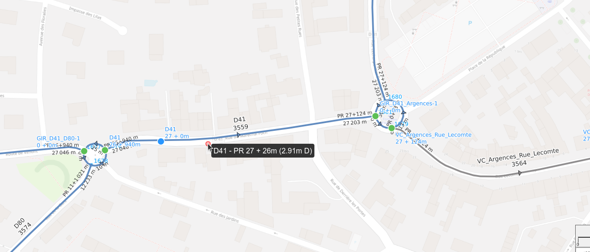
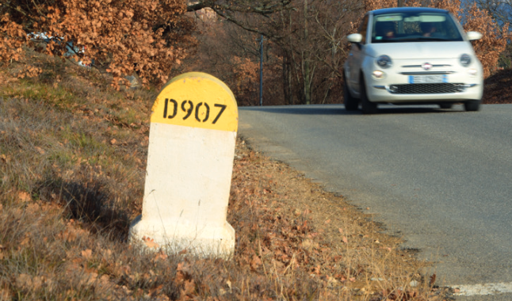
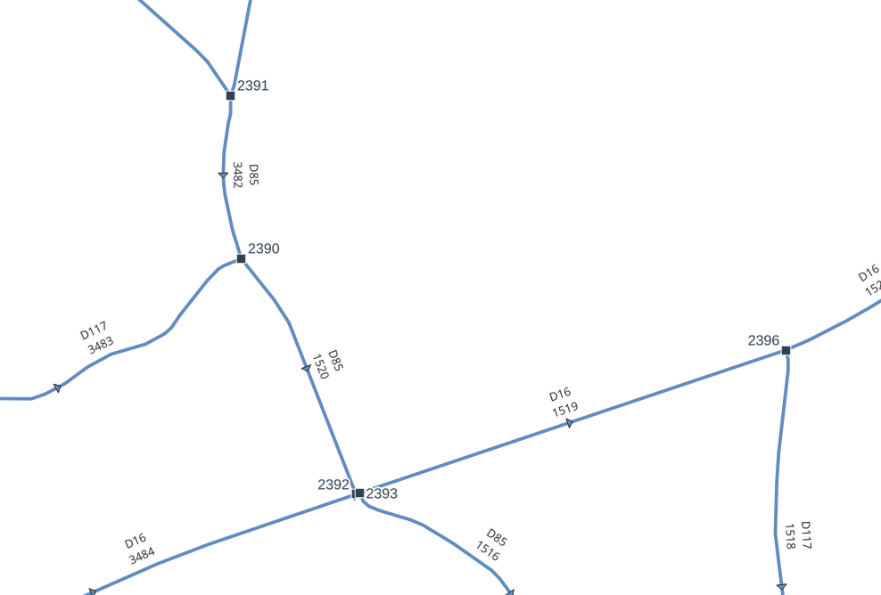
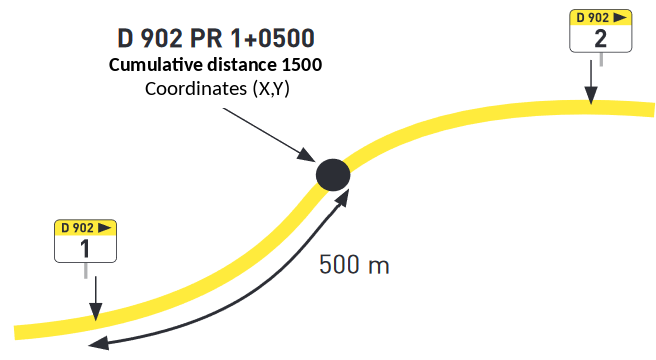
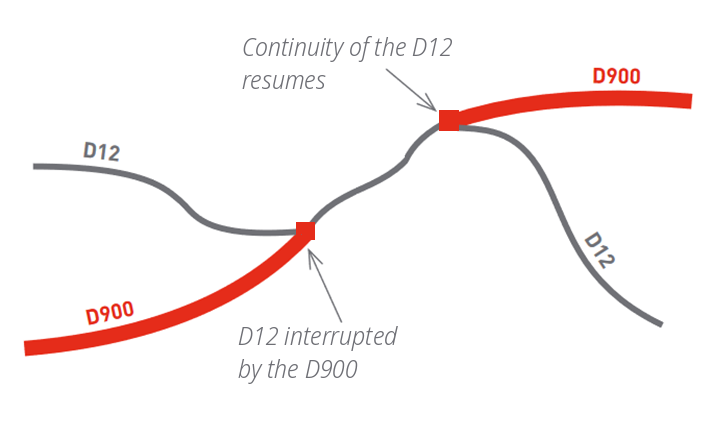
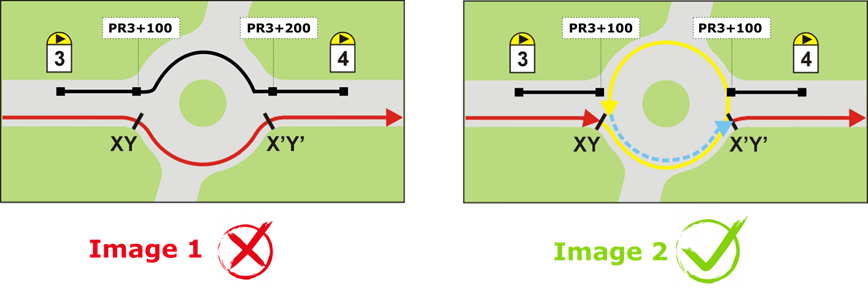

# Presentation of the plugin concepts

The RoadNetwork plugin helps to manage a **topological county road network**
and to perform **linear referencing** with **QGIS** and **PostGIS**.

## Road network

Each **road**:

* has an **identification**, e.g. `D907`,
* is composed of a **series of ordered edges** (simple linestrings).

**Markers** are positioned along the roads. Their position is often measured with a **GPS** `(X,Y)`.

## Topology

The road network is a **graph** built with **edges** and **nodes**:

* each edge has a **start node** and an **end node**,
* an edge can have a **previous** edge and a **next** edge,
* **intersecting edges** are cut by a **node** (if they are on the same level).

## Position and references

This simple organization of **roads, edges and markers** allows to determine
the position of any object based on:

* a **road code**: `D902`,
* a **marker code**: `1`,
* an **abscissa**: `500m`.

You can also provide an optional **offset**, e.g. `3m`, and a **side**, e.g. `left`.

Any point within a distance of **50m** of any road will have its **references**:
`D902 PR 1 + 500m (3m left)`.

## Linear referencing

Each data object, **point** or **(multi)linestring**, is defined by its **references**
calculated from the road network:

* **Points**: trees, street lights, car accidents, etc.
* **Linestrings**: paintings, safety barriers, roadworks, etc.

We must be able to:

* **calculate the references** from the object geometry,
* **create a geometry** based on given references:
    * a **point**,
    * a **multi-linestring** between two references.

## Corner cases

**Discontinuity**: edges could have been deleted (or have changed status).

**Roundabouts** have their own road code, e.g. `GIR D35-D80`, and cut the other roads.

## Glossary

| Concept | Definition |
|---------|------------|
| Graph | A directed graph made of a set of edges and nodes representing the road network as a road centerline network, matching the axis of the carriageway. |
| Road | A consecutive sequence of edges forming a road / a way (e.g. D115). |
| Edge | Portion of a road. An edge is a directed segment linking two nodes (simple line). |
| Node | The nodes represent the start and end vertices of each edge. |
| Marker | Point created by the road network manager, physically materialized on the ground by painted marks associated with kilometer markers. |
| Virtual marker | Point created by the GIS administrator to make the administration of the graph easier, especially the computation of the reference point + abscissa. |
| Reference point (PR, *point de repère*) | Formerly known as kilometer point. |
| Business or thematic data | Set of thematic data overlaid on the graph and topologically linked to it. It can be point data (e.g. road signs) or linear data (e.g. pavement surface). |
