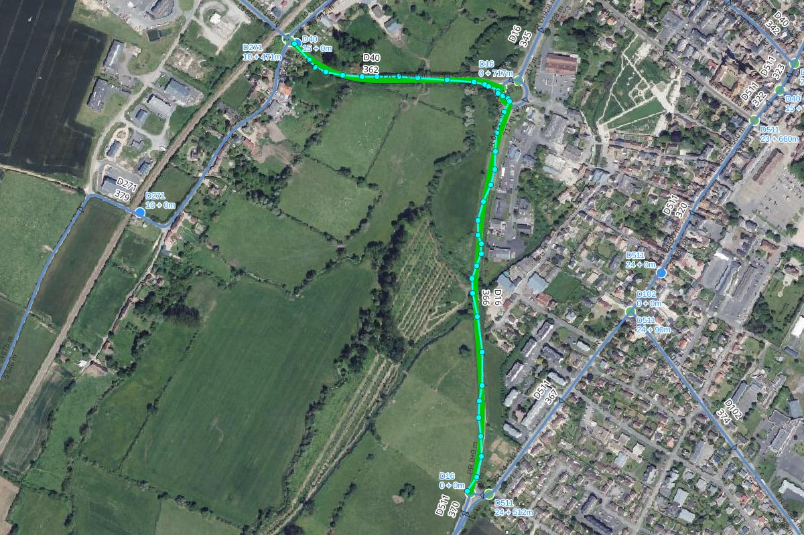
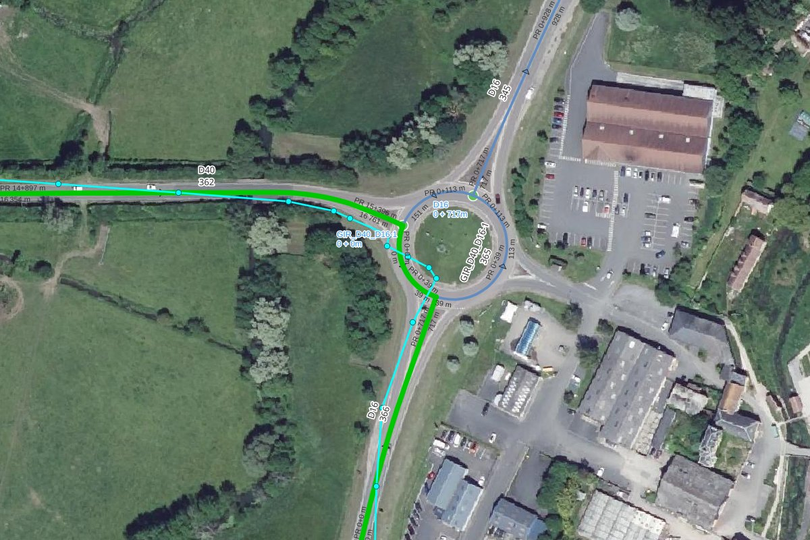

# Useful functions

The `road_graph` schema provides SQL functions which can be used directly in your queries,
for example in the QGIS **Browser** panel (right-click on the PostgreSQL connection or schema, then `Execute SQL…`),
in `psql` or in a **virtual layer** built on a PostgreSQL query.

## GPS tracks: from a GPX file to the road references

A GPS track recorded on the road, for example with a smartphone and exported as a **GPX file**,
is never exactly on the road graph edges: the GPS precision is usually between **5 and 15 meters**.

Two functions allow to transform such a track into **road references**:

1. `road_graph.get_snapped_line_from_track` builds a line **snapped on the road graph edges**
   from the imprecise GPS track,
2. `road_graph.get_road_sections_from_snapped_line` returns the **ordered list of the roads** followed by this line,
   with the **start and end references** (marker and abscissa) for each road.

### Import the GPX file in PostgreSQL

A GPX file can be opened in QGIS with a drag & drop: choose the `tracks` layer.
Then import it in the PostgreSQL database with the QGIS **Browser** panel: drag & drop the layer
from the `Layers` panel onto the target schema of your PostgreSQL connection.
The Processing algorithm `Export to PostgreSQL` can also be used.

The import can also be done with `ogr2ogr`:

```bash
ogr2ogr -f PostgreSQL PG:"service=my_service" my_track.gpx tracks \
  -nln gps.tracks -lco GEOMETRY_NAME=geom -lco FID=id
```

!!! tip
    The tracks can stay in the GPS projection `EPSG:4326`: the functions reproject them automatically
    to the road graph projection. A geometry **without SRID** is considered to be already
    in the road graph projection.

### Snap the track on the road graph

```sql
SELECT road_graph.get_snapped_line_from_track(
    _track => t.geom,
    _densify_distance => 2,
    _max_distance => 25,
    _road_change_penalty => 100
) AS geom
FROM gps.tracks AS t
WHERE t.id = 1
;
```

Only the first parameter is required:

| Parameter              | Default | Description                                                                                  |
|------------------------|---------|----------------------------------------------------------------------------------------------|
| `_track`               |         | The GPS track: a linestring or a multilinestring, in any projection                          |
| `_densify_distance`    | `2`     | Distance in meters between the points added to the track before snapping them                |
| `_max_distance`        | `25`    | The track points further than this distance (meters) from any edge are ignored               |
| `_road_change_penalty` | `100`   | Penalty applied each time the road changes. Increase it if the result still has zigzags      |

The function returns a **multilinestring** in the road graph projection, which **follows exactly the edges geometries**,
in the **direction of the track**.

In the example below, the GPS track and its points are displayed in **cyan**, and the snapped line in **green**.
The track goes from the road `D40` to the road `D16` through the roundabout `GIR_D40_D16-1`:



Near the roundabout, the GPS track cuts the curves and crosses the roundabout,
whereas the snapped line follows the edges of the 3 roads:



How does it work?

* The track is **densified** with a point every `_densify_distance` meters.
* For each point, all the roads closer than `_max_distance` are candidates.
* Simply taking the closest road for each point would produce **zigzags between two close roads**
  (parallel roads, intersections, roundabouts). Instead, the function searches the **sequence of roads**
  which minimizes, for the whole track:
    * the distance between the points and their road (multiplied by `_densify_distance`, which gives
      approximately the surface in m² between the track and the roads),
    * plus `_road_change_penalty` **each time the road changes** between two consecutive points.
* Each point is then snapped on the closest edge of its road. The small back and forth movements
  created near the intersections are removed.
* If two consecutive edges are not connected, for example when a short roundabout section has been skipped,
  the gap is filled with the **shortest path** of maximum 5 edges. If no path is found,
  a new part is created in the multilinestring.
* The result is built from the **edges geometries**, from node to node.

### Get the road sections references

```sql
SELECT s.*
FROM road_graph.get_road_sections_from_snapped_line(
    road_graph.get_snapped_line_from_track(
        ST_GeomFromText('LINESTRING(-0.044052 49.020203, -0.043663 49.019952, ...)', 4326)
    )
) AS s
;
```

The function returns **one line per road section**, ordered along the line:

| road_order | road_code     | start_marker | start_abscissa | start_cumulative | end_marker | end_abscissa | end_cumulative | direction  | length |
|------------|---------------|--------------|----------------|------------------|------------|--------------|----------------|------------|--------|
| 1          | D40           | 14           | 905.27         | 16361.8          | 15         | 396.15       | 16761.4        | downstream | 399.6  |
| 2          | GIR_D40_D16-1 | 0            | 0              | 0                | 0          | 39.17        | 39.17          | downstream | 39.17  |
| 3          | D16           | 0            | 716.82         | 716.82           | 0          | 1.62         | 1.62           | upstream   | 715.19 |

* `start_marker` & `start_abscissa`: the references of the section start, e.g. `14+905.27`,
* `end_marker` & `end_abscissa`: the references of the section end,
* `start_cumulative` & `end_cumulative`: the distances from the road start,
* `direction`: `downstream` if the line follows the road direction, `upstream` otherwise,
* `length`: the section length in meters,
* `geom`: the section geometry (linestring).

The second parameter `_tolerance` (default `1` meter) is the maximum distance between the line and the edges.
The line must follow the road graph edges: use the result of `get_snapped_line_from_track`.

### Process all the tracks of a table

```sql
-- Snapped tracks
CREATE TABLE gps.snapped_tracks AS
SELECT
    t.id,
    road_graph.get_snapped_line_from_track(t.geom) AS geom
FROM gps.tracks AS t
;

-- Road sections of each track
CREATE TABLE gps.track_road_sections AS
SELECT
    st.id AS track_id,
    s.*
FROM gps.snapped_tracks AS st
CROSS JOIN LATERAL road_graph.get_road_sections_from_snapped_line(st.geom) AS s
ORDER BY st.id, s.road_order
;
```

### Limitations

* A **U-turn in the middle of an edge** is not kept: the line leaves the edge by the node it came from.
* With a very imprecise track (more than ~10 meters) in **complex areas** like highway interchanges,
  the result can contain wrong ramps, mainly at the track start or end.
  Increase `_road_change_penalty`, or cut the track ends.
* The points further than `_max_distance` from the road graph are ignored. If the track leaves the road graph
  for a long distance, the result can be split into several parts.
