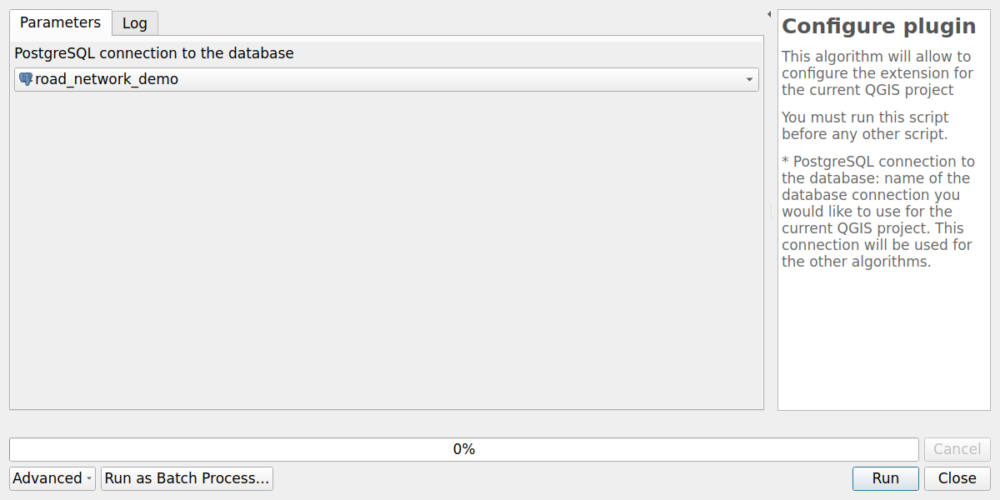
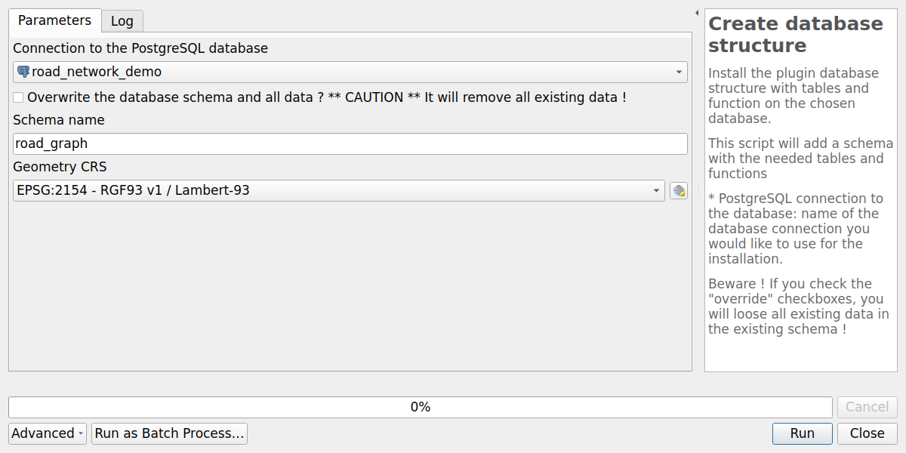
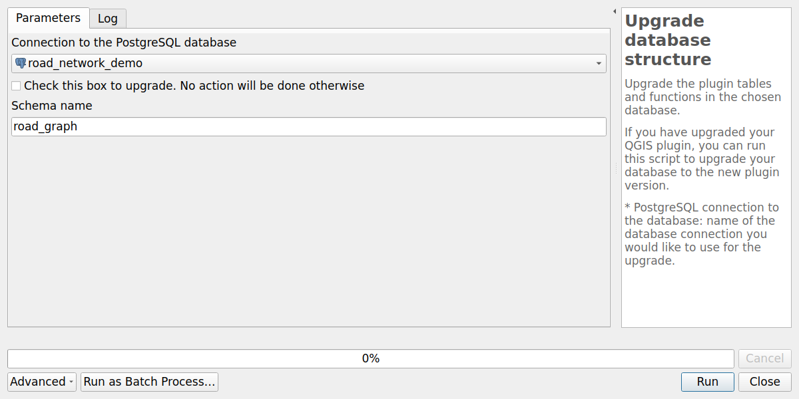
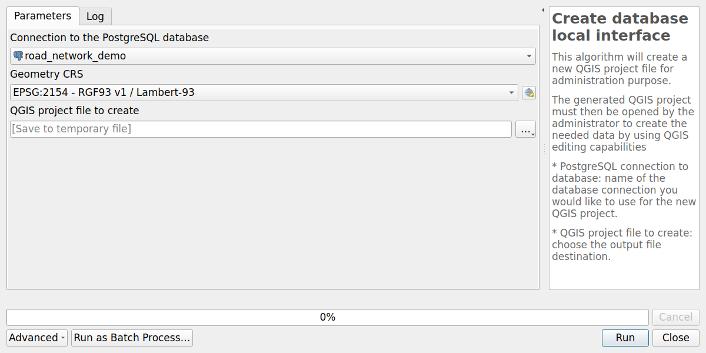

# Introduction

To use the plugin, you need to:

* install QGIS Desktop
* install the plugin for QGIS
* add a connection to a PostgreSQL database with PostGIS extension
* install the database structure on this PostgreSQL database

## Get QGIS Desktop

The administrator must use the **QGIS desktop software**, version 3.40.x or above, to edit these needed metadata.

You can download QGIS in the [official download page](https://qgis.org/fr/site/forusers/download.html)

## Install the plugin

At present, the plugin is not yet in QGIS official plugin repository. To install the plugin, you need to:

* open QGIS **Plugin manager** (menu Plugins)
* In the **All** tab, search for the word `RoadNetwork` and install the **RoadNetwork** plugin.

After a successful installation, you should see a new dock called **RoadNetwork**

For further details, you can have a look at [3liz documentation web page](https://3liz.github.io/add_qgis_repository.html).

## Add a connection to the PostgreSQL database

The plugin stores all the data in a **PostgreSQL database**, with the PostGIS extension installed (to manage spatial data).

You need to have access to a PostgreSQL database, with enough rights to create a database **schema** and **tables** inside this schema.

In QGIS, use the **Datasource manager** under the **Layer** menu to create a new PostgreSQL connection:

* Activate the **PostgreSQL tab** (elephant icon)
* Click on the **New** button
* In the creation dialog, fill the needed information, and use the **Test connection** button to make sure the credentials are ok.

We advise to:

* use a **service connection** instead of the basic authentication. See [QGIS documentation](https://docs.qgis.org/3.4/fr/docs/user_manual/managing_data_source/opening_data.html#postgresql-service-connection-file)
* check the boxes `Use estimated table metadata` and `Also list tables with no geometry`

Once your connection is set up, you can create the database structure in your PostgreSQL database

## Configure the plugin

This algorithm will allow to configure the extension for the current QGIS project.

You must run this script before any other script.

Parameters:

* `PostgreSQL connection to the database`: name of the database connection you would like to use for the current QGIS project. This connection will be used for the other algorithms.

## Create the database structure

Install the database structure with tables and function on the chosen database connection.

This script will add a `road_graph` schema with needed tables and functions.

Parameters:

* `Connection to the PostgreSQL database`: name of the database connection you would like to use for the installation.
* `Overwrite the database schema and all data ?`: if the schema already exists in the database,
  the algorithm stops with an error, unless this box is checked.
  In this case, the existing schema is **dropped with all its data** and created again.
  Unchecked by default.
* `Geometry CRS`: coordinate reference system of the geometries stored in the database.
  It must be a valid EPSG code. Default: `EPSG:2154 - RGF93 v1 / Lambert-93`.

## Upgrade database structure

Upgrade the tables and functions in the chosen database.

If you have upgraded your QGIS plugin, you can run this script to upgrade your database to the new plugin version.

Parameters:

* `Connection to the PostgreSQL database`: name of the database connection you would like to use for the upgrade.
* `Check this box to upgrade. No action will be done otherwise`: safety checkbox.
  The algorithm refuses to run if it is not checked.

The coordinate reference system is not asked: it is read from the existing `edges` table.

## Create your database local interface

This algorithm will create a **new QGIS project file** for administration purpose.

The generated QGIS project must then be opened by the administrator
to **edit the road network data** by using QGIS editing capabilities

Parameters:

* `Connection to the PostgreSQL database`: name of the database connection
  you would like to use for the new QGIS project.
* `Geometry CRS`: coordinate reference system of the QGIS project and its layers.
  Use the same CRS as the one chosen when creating the database structure.
  Default: `EPSG:2154 - RGF93 v1 / Lambert-93`.
* `QGIS project file to create`: choose the output file destination.
  We advise you to choose a name reflecting the database name.

You can then open the generated QGIS project.
