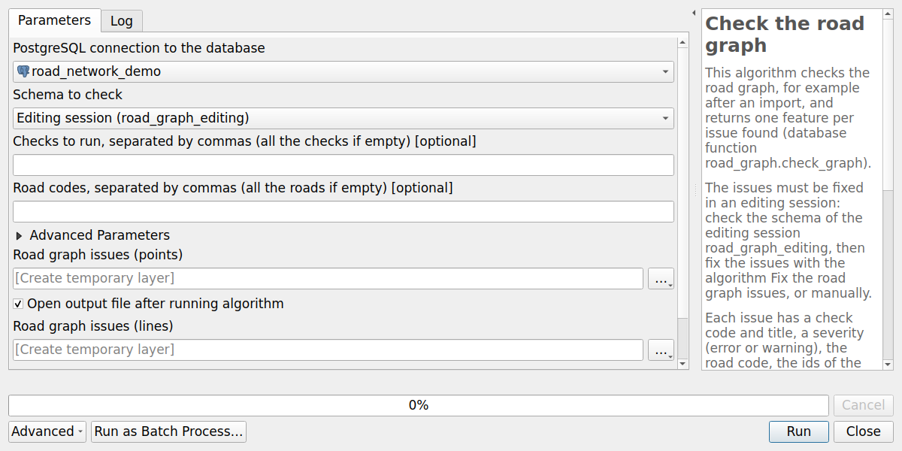
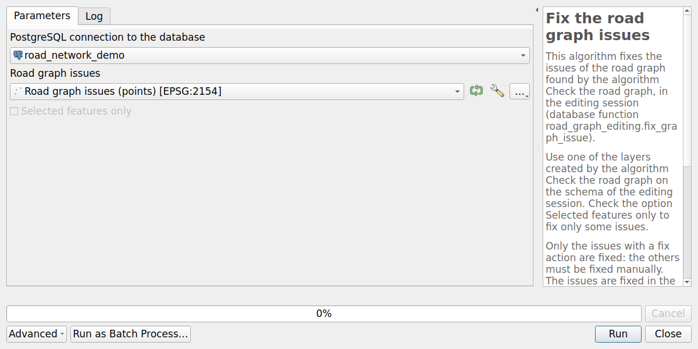
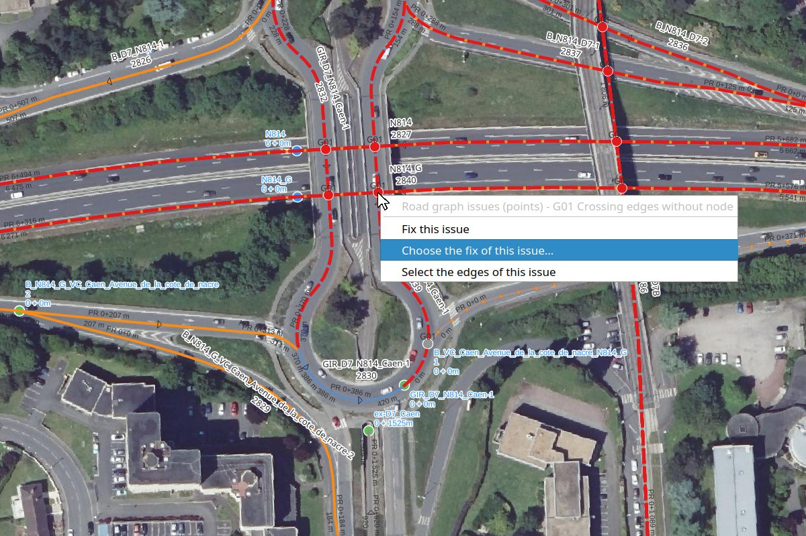
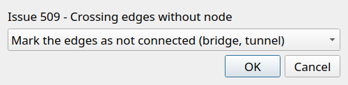
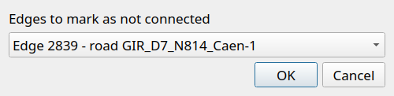

# Check and fix the road graph

After an [import](import.md), the road graph often contains issues coming from the source data:
crossing edges which are not cut, edges which should touch but do not, edges drawn in the opposite
direction of the road, branches of a road using the code of the main road, etc.

The plugin provides tools to **find these issues** and, when possible, to **fix them automatically**.

## Workflow

The issues must be fixed in an **editing session**, like any other modification of the road graph
(see [Road graph editing](graph-editing.md)). Even after an import, use an editing session:
draw a large editing session polygon if needed.

1. Create an editing session covering the area to check.
2. Run the algorithm **Check the road graph** on the schema of the editing session.
   It creates two layers: a **point** layer locating each issue,
   and a **line** layer showing the issues for which a line is useful.
3. Review the issues, and fix them:
    * one by one with a **right click** on the issue (see [Fix an issue with a right click](#fix-an-issue-with-a-right-click)),
    * or in batch: select the issues to fix automatically, then run the algorithm **Fix the road graph issues**
      with the option **Selected features only**. The issues already fixed are skipped,
    * or manually, for the issues without fix action (see the description of each check).
4. Run the algorithm **Check the road graph** again to check the result.
5. Merge the editing session.

If the layers of the editing session are in **editing mode**, the fixes are run in their **transaction**:
save the modifications of the layers afterwards, or cancel them. Else the fixes are saved at once.

## Algorithms

The algorithm **Check the road graph** runs the checks on the schema of the editing session (or of the production,
only to get an overview of the issues), for all the roads or only some of them, and creates the issues layers.
The advanced parameter **Options of the checks** overrides the default options of the checks.



The algorithm **Fix the road graph issues** fixes the issues of one of these layers, in the order of their check codes,
with their fix action. Check the option **Selected features only** to fix only the selected issues.
The issues without fix action, and the issues already fixed, are skipped.



## Fix an issue with a right click

The layers created by the algorithm Check the road graph have three **actions**.
Use the `Identify Features` tool and **right-click** on an issue in the map,
or use the `Run Feature Action` tool of the `Attributes` toolbar:

* **Fix this issue**: fix the issue with its fix action. Nothing is done if the issue has no fix action,
* **Choose the fix of this issue…**: choose the fix action among the actions of the check, then fix the issue.
  For example, for the check G01, cut the edges or mark them as not connected (bridge),
  and in this case choose the edge to mark,
* **Select the edges of this issue**: select the edges of the issue in the edges layer of the editing session
  (`road_graph_editing.edges`) and zoom on them, for example to fix the issue manually.

In this example of the test data, the roads of an interchange cross the N814 on bridges without being connected,
and an access road arrives on the roundabout without splitting it. This last issue has already been fixed:
it is displayed in grey. A right click on a crossing of the N814 shows the actions:



The action **Choose the fix of this issue…** lists the fix actions of the check:



For the action `mark_as_bridge`, choose then the edge which must not be connected, or all the edges:



The result of the fix is stored in the fields `fix_status` (`Fixed`, `Already fixed` or `Not fixed`)
and `fix_message` of the points and lines layers of the issues, and the fixed issues are displayed in grey.
The edges layers of the editing session are refreshed.

The titles of the checks and of the actions, the labels of the fix actions and statuses and the messages
are translated in the language of QGIS. The detailed messages returned by the database are in English.

## Checks

Each issue has:

* a **check code** and title, and a **severity**: `error` or `warning`,
* the **road code**, and the ids of the **edges**, **nodes** and **markers** concerned,
* some **details**, for example a distance or an angle,
* the **fix action** which can fix it automatically, and its parameters,
  or nothing if the issue must be fixed manually.

The checks are numbered in the recommended order of the fixes:
the algorithm Fix the road graph issues fixes the issues in this order.

| Code | Issue | Fix |
|------|-------|-----|
| [G01](#g01-crossing-edges-without-node) | Edges crossing or touching each other without node | `cut_edges` or `mark_as_bridge` |
| [G02](#g02-edge-ending-near-another-edge) | Edge ending near another edge without being connected (T junction) | `extend_edge` |
| [G03](#g03-nodes-close-to-each-other) | Nodes close to each other | `merge_nodes` |
| [G04](#g04-useless-node) | Useless node: without edge, or between two edges of the same road | `delete_node` |
| [G05](#g05-edges-in-the-opposite-direction-of-the-road) | Edges in the opposite direction of the road | `reverse_edges` |
| [G06](#g06-road-with-branches) | Road with branches: more than two edges of the road at a node | manual |
| [G07](#g07-parallel-edges-of-the-same-road) | Parallel edges of the same road, for example two carriageways | manual |
| [G08](#g08-short-edge) | Short edge | `collapse_edge` |
| [G09](#g09-first-marker-not-at-the-start-of-the-road) | First marker not at the start of the road | `move_marker` |

To fix an issue with another action than the proposed one, or to choose the action of an issue without action,
toggle the editing mode of the point layer created by the algorithm Check the road graph,
and change the field `fix_action` (and `fix_params` if needed) before running the algorithm Fix the road graph issues.

### G01: Crossing edges without node

Two edges crossing or touching each other must be split by a node, unless they are not connected,
for example on a **bridge** or in a **tunnel**: the edges with the field `no_intersection_cutting` set to `True`
are ignored (see [Edges which must not be cut](graph-editing.md#edges-which-must-not-be-cut)).

The check returns one issue for each point where two edges cross or touch each other,
if this point is not the start or end point of both edges (50 cm tolerance, like the triggers splitting the edges).
The field `details` gives:

* `crossing_type`:
    * `touching`: the point is the start or end point of one of the edges, for example a road arriving on another road
      without splitting it. The edges are surely connected: the fix action is `cut_edges`,
    * `crossing`: the edges cross each other. They may be on a bridge: **the fix action must be chosen for each issue**,
* `road_codes` and `road_classes`: the codes and classes of the roads of the two edges,
  for example a highway crossing a departmental road is probably a bridge,
* `angle`: the angle between the two edges, from 0 (parallel) to 90 degrees (perpendicular).

Fix actions:

* `cut_edges`: create a node at the point, or use the existing node less than 50 cm from it,
  which splits the edges passing there,
* `mark_as_bridge`: set the field `no_intersection_cutting` to `True` for the two edges,
  or only for the edge given by the key `edge_id` added to `fix_params`, for example
  `{"point": "SRID=2154;POINT(455144.6 6905485.8)", "edge_ids": [2839, 2841], "edge_id": 2839}`.

If most of the crossings are bridges, or are crossroads, set the option `crossing_fix_action`
of the check to `mark_as_bridge` or `cut_edges`: the issues of type `crossing` then get this fix action.
Check the result carefully afterwards.

```sql
UPDATE road_graph.glossary_graph_check
SET default_options = default_options || '{"crossing_fix_action": "mark_as_bridge"}'
WHERE code = 'G01';
```

### G02: Edge ending near another edge

A road arriving on another road must be connected to it. In the source data, it often stops
a few decimeters before the other road, or a little beyond it.

The check returns one issue for each **free end** of an edge, i.e. an end with no other edge connected to it,
located less than the **tolerance** from another edge: option `tolerance`, **2 m** by default.
Are ignored:

* the edges connected to the opposite end of the edge, for example its next edge if it is very short,
* the edges crossed by the edge near its free end: the edge goes a little beyond the other edge.
  The crossing is found by the check [G01](#g01-crossing-edges-without-node).

When two free ends are close to each other, only one issue is returned.

The **point to join** is the closest point of the other edge, or its start or end point
if it is less than 50 cm from it. The field `details` gives the road codes of the two edges,
the `distance`, and the `join_type`: `edge` (middle of the other edge) or `edge_end`.

Fix action:

* `extend_edge`: connect the free end of the edge to the point to join:
    * if the point to join is the start or end point of the other edge, the free end is connected to its node,
      and the node of the free end is deleted,
    * else, if the free end is less than 50 cm from the other edge, the node of the free end is moved
      to the point to join,
    * else, the point to join is added at the free end of the edge, and the node of the free end follows.

  In the two last cases, the triggers split the other edge there.
  Like any geometry of the road graph, the coordinates are rounded to 10 cm.

```sql
-- Find the gaps up to 3 m
UPDATE road_graph.glossary_graph_check
SET default_options = default_options || '{"tolerance": 3}'
WHERE code = 'G02';
```

### G03: Nodes close to each other

Two nodes a few centimeters or decimeters from each other should usually be the same node:
the roads arriving there are not connected in the graph.

The check returns one issue for each pair of nodes less than the **tolerance** from each other:
option `tolerance`, **1 m** by default. The nodes linked by an edge are ignored: this edge is very short,
and must be examined with the check of the short edges.

The **node to keep** is the node with the **most edges**, so that the fewest edges are moved,
or else the node with the **lowest id**, i.e. the oldest node.
It is the first node of `node_ids`, and the point of the issue.
The field `details` gives the road codes of the edges of the two nodes and the `distance`.

Many of these issues are also found by the check [G02](#g02-edge-ending-near-another-edge),
when an edge ends near the start or end point of another edge: they are skipped once fixed by G02.

Fix action:

* `merge_nodes`: move the start and end points of the edges of the other node to the node to keep,
  then delete the other node.

### G04: Useless node

A node is useful at a junction, or at the start or end of a road. The source data often contains
other nodes, for example where the source features of a road were split: these nodes split the road
into several edges for nothing.

The check returns one issue, with the severity `warning`, for each node:

* without edge (`node_type`: `no_edge`), only when all the roads are checked,
* or between two edges of the same road (`node_type`: `two_edges`): one edge arrives at the node,
  and the other one leaves it. Are ignored the edges with different values of `no_intersection_cutting`,
  the two edges forming a loop, and the edges crossing each other, for example a loop ramp of an interchange.

Two edges of the same road arriving both at the node, or leaving it both, are in opposite directions:
this issue is found by the check of the reversed edges.

Fix action:

* `delete_node`: delete the node. The triggers merge the two edges into the edge with the lowest id,
  which keeps its other fields, for example `id_source`.

Fix the issues of the checks G01 and G03 before: else the triggers would split the merged edge
at its crossings with the other edges, which may be bridges, or connect it to the close nodes.
In this case, the fix returns an error and nothing is changed.

### G05: Edges in the opposite direction of the road

The edges of a road must be drawn in the direction of the road, from its first marker to its last one:
the references (marker and abscissa) and the order of the edges depend on it.

The check groups the edges of each road in **sequences**: two edges follow each other at a node
where there are only these two edges of the road. The **direction of a sequence** is given:

* by the order of the **markers** of the road located along it (`reason`: `markers`),
  less than the option `marker_tolerance` from it, **10 m** by default,
* or else, without enough markers, by the direction of most of the length of its edges (`reason`: `neighbours`).

The markers of the roundabouts are not used, and the roundabouts, whose edges form a ring, are not checked.
The direction of an edge is given by its geometry, not by its fields `start_node` and `end_node`.

The check returns one issue for each group of consecutive edges in the opposite direction of their sequence.
A whole road drawn in the opposite direction of its markers is also found.
The field `details` gives the `reason`, the number of edges and their length, and the number of consecutive markers
in the direction of the road (`markers_in_road_direction`) and in the opposite direction.

Fix action:

* `reverse_edges`: reverse the geometry of the edges. The triggers swap their start and end nodes,
  and calculate again their previous and next edges and the references of the road.

A geometry can also be reversed manually, for example with the QGIS tool `Reverse Line`.

```sql
-- Use the markers up to 20 m from the edges
UPDATE road_graph.glossary_graph_check
SET default_options = default_options || '{"marker_tolerance": 20}'
WHERE code = 'G05';
```

### G06: Road with branches

A road must be a line: its edges follow each other, without branches. The ramps of an interchange or of a roundabout,
or the two carriageways of a road, must have their own road code. Else the order of the edges of the road,
and so the references, cannot be calculated.

The check returns one issue for each node with **more than two edges of the same road**. The roundabouts are ignored.
The **main line** of the road at the node is given by the edge arriving at the node and the edge leaving it
which are the most aligned: the other edges are the **branches**. The field `details` gives the number of edges
at the node (`edge_count`), and the ids of the edges of the main line (`main_edge_ids`) and of the branches
(`branch_edge_ids`). The line of the issue shows the branches.

There is no fix action: give another road code to the edges of the branches, for example a new road
for a ramp. Check the main line proposed by the check, especially when the edges are not in the direction of the road
(check [G05](#g05-edges-in-the-opposite-direction-of-the-road)).

### G07: Parallel edges of the same road

The two carriageways of a road must have their own road code. When they use the same code without being connected,
the check [G06](#g06-road-with-branches) does not find them.

The check returns one issue, with the severity `warning`, for each pair of edges of the same road,
not connected by a node, which **run along each other**:

* less than the option `tolerance` from each other, **30 m** by default,
* along at least the option `min_length`, **10 m** by default.

The edges which only approach each other are ignored, for example the edges of a road on both sides of a roundabout:
each edge must run along the other one on at least the minimum length. The roundabouts are ignored.
The field `details` gives the `distance` between the edges and the length along which they are parallel
(`parallel_length`). The line of the issue shows the parallel parts of the edges.

There is no fix action: give another road code to one of the carriageways. A road which comes back near itself,
for example a hairpin bend, can also be found: in this case, there is nothing to fix.

### G08: Short edge

A very short edge often comes from the digitizing: for example two junctions a few decimeters from each other
instead of a crossroads, or a small piece of road left at the end of an edge.

The check returns one issue for each edge shorter than the option `min_length`, **3 m** by default.
The edges of the **roundabouts**, and the edges arriving at a roundabout or leaving it, are often short:
they are ignored, unless they are reduced to a point (less than 10 cm, the precision of the coordinates).
The severity is `error` for an edge reduced to a point, else `warning`.
The field `details` gives the `length`, the number of other edges at the start and end nodes
(`start_edge_count` and `end_edge_count`), and `is_roundabout_edge`.

Fix action:

* `collapse_edge`: delete the edge and merge its two nodes into the **node to keep**: the node with the most edges,
  or else the node with the lowest id, which is the first node of `node_ids`.
  At the other node, the next or previous edge of the **same road** is extended with the geometry of the short edge
  up to the node to keep: the geometry and the length of the road are kept.
  The start and end points of the edges of the **other roads** are moved to the node to keep:
  their last segment is redirected, by less than the length of the short edge.

The only edge of a road has no fix action: the road would not have any edge anymore.

### G09: First marker not at the start of the road

The **first marker** of a road is the marker with the lowest code and abscissa: it is often the marker 0,
but it can be a virtual marker with a higher code. It must be at the **start point of the first edge** of the road,
the edge without previous edge. When it is a few centimeters after it, the start of the road has no reference.

The check returns one issue for each road whose first marker is more than 5 cm from the start of the road.
The roundabouts are ignored. The severity is `error` if the start of the first edge has no reference, else `warning`.
The field `details` gives the `marker_code`, `marker_abscissa` and `is_virtual` of the marker, its `distance`
to the start of the road, its position along the first edge (`position_on_edge`), and `has_start_reference`.

Fix action:

* `move_marker`: move the marker to the start of the road. The references of the road are calculated again.
  It is only proposed when the marker is less than the option `tolerance` from the start of the road,
  **1 m** by default. Farther, check the road manually: the marker may be right, and the first edge wrong,
  for example when the road is in the opposite direction (check [G05](#g05-edges-in-the-opposite-direction-of-the-road)).

## Configuration of the checks

The checks are listed in the table `road_graph.glossary_graph_check`, with for each check:
its code, title, severity, function, fix actions and description.
The rows are added by the plugin migrations. The administrator can modify two columns:

* `default_options`: the default options of the check, for example its tolerance in meters,
* `is_active`: uncheck it to stop running the check by default. It is still run if it is explicitly asked.

```sql
-- Give the action mark_as_bridge to the edges crossing each other found by the check G01
UPDATE road_graph.glossary_graph_check
SET default_options = default_options || '{"crossing_fix_action": "mark_as_bridge"}'
WHERE code = 'G01';
```

The checks are always read from the production schema, even when the editing session is checked.

## Database functions

The algorithms use the following database functions, which can also be used directly in SQL.
They are installed in the production schema `road_graph` and in the editing schema `road_graph_editing`.

* `road_graph.check_graph(_checks, _road_codes, _options)`: run the checks and return one line per issue.
  All the active checks are run if `_checks` is `NULL`, and all the roads are checked if `_road_codes` is `NULL`.
  The parameter `_options` overrides the default options of the checks, with the check code as key.

```sql
-- Check all the roads of the editing session
SELECT * FROM road_graph_editing.check_graph();

-- Check only some roads, with some checks and an option
SELECT *
FROM road_graph_editing.check_graph(
    ARRAY['G01'],
    ARRAY['D40', 'D16'],
    '{"G01": {"crossing_fix_action": "cut_edges"}}'
);
```

* `road_graph_editing.fix_graph_issue(_fix_action, _params)`: fix an issue with its fix action and parameters.
  It only works in the editing schema. It returns a JSON object with the keys `status`
  (`success`, `skipped` if the issue has already been fixed, or `error`) and `message`.

```sql
SELECT road_graph_editing.fix_graph_issue(i.fix_action, i.fix_params)
FROM road_graph_editing.check_graph(ARRAY['G01']) AS i
WHERE i.fix_action IS NOT NULL
ORDER BY i.id;
```
