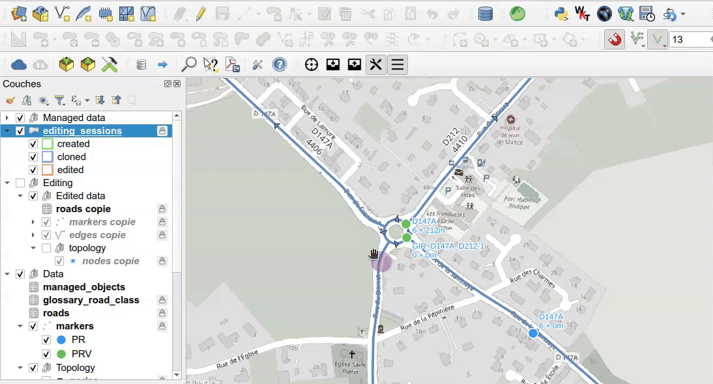
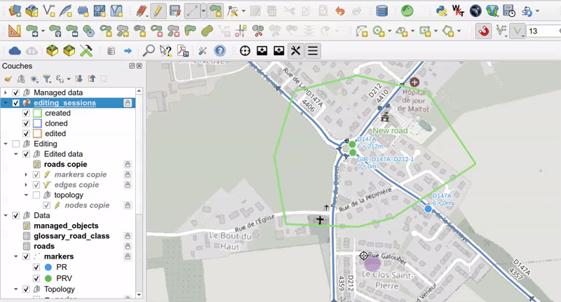
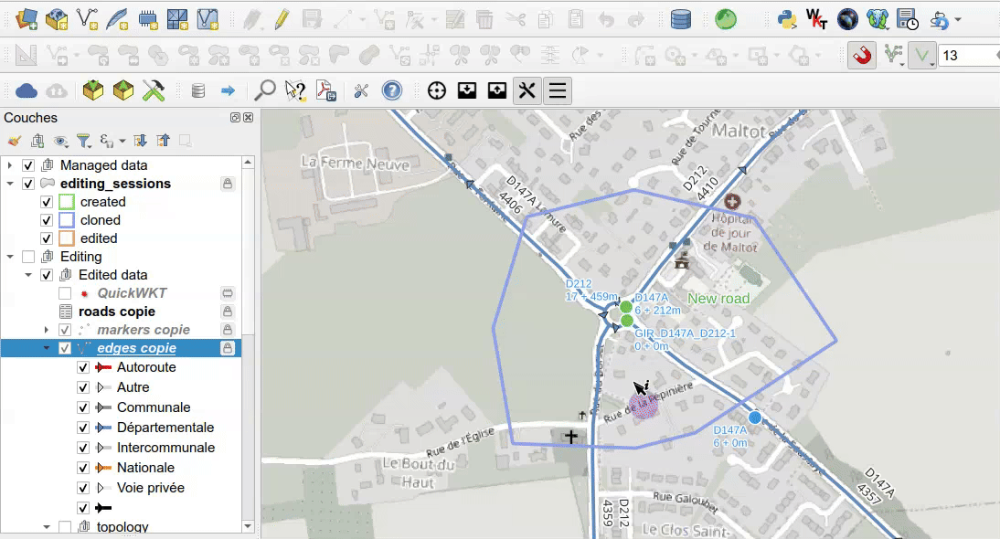
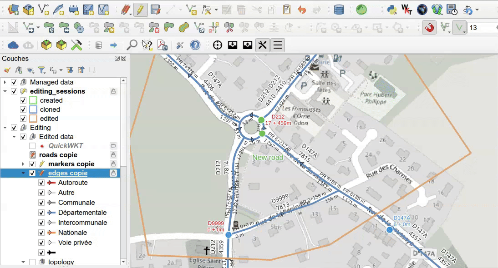
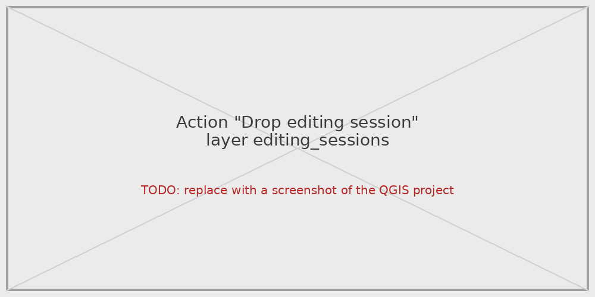
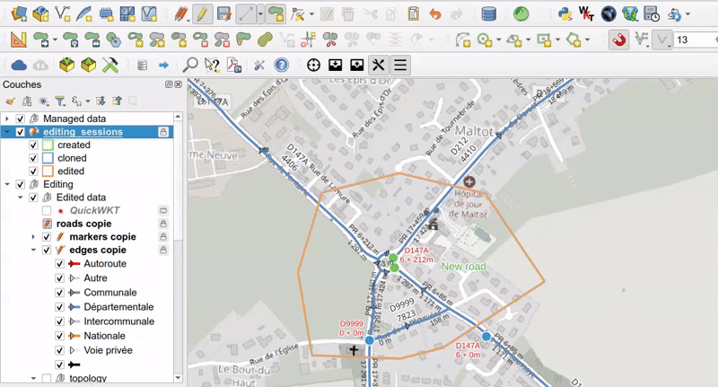
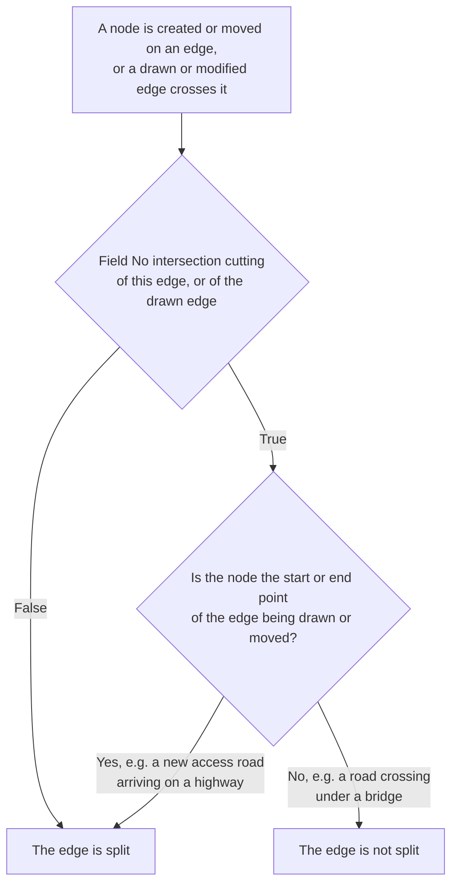
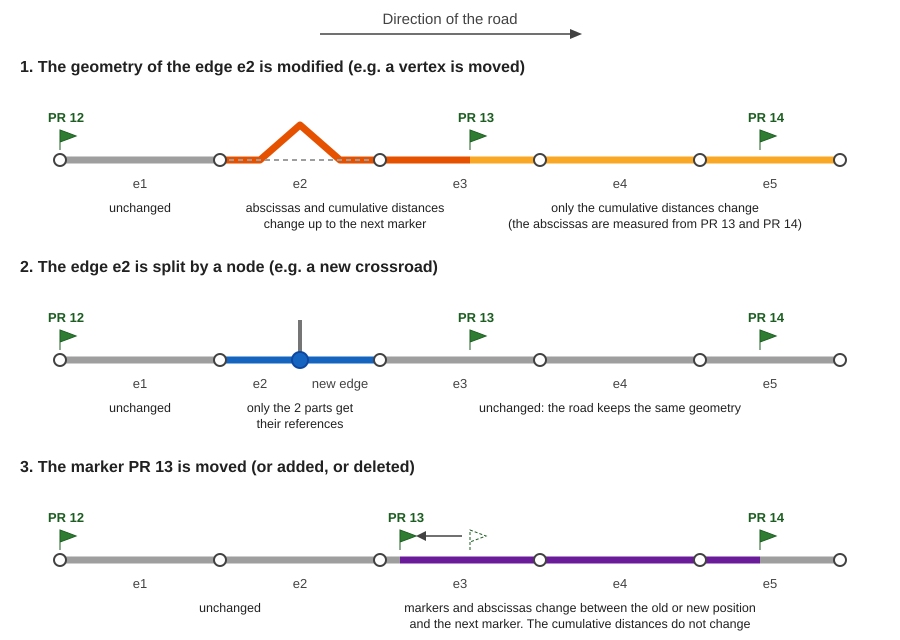

# Road graph editing

## Editing rules

The road graph data are **not edited directly** in the production schema `road_graph`,
but in a **dedicated editing session schema** `road_graph_editing`, which acts as a sandbox.
The editing is made in four steps, described below.

At any time, the modifications of the editing session can be highlighted with the action
[Display edited data](#display-edited-data), and the editing session can be cancelled
with the action [Drop editing session](#drop-editing-session).

### Draw the editing session polygon

The user **draws a polygon** in the `editing_sessions` layer around the area to edit.
The new editing session has the status `created`.

### Clone the data into the sandbox

The algorithm `Clone data to a new editing session` (toolbar button `Clone data to the editing sandbox`,
or layer action [Create editing session](#create-editing-session))
**copies an extract of the production data** inside this polygon into the sandbox.
The status becomes `cloned`.

### Edit the data

The **editing** is made with the **QGIS tools**: forms, topological editing, etc.
The status becomes `edited` after the first change.

* QGIS **automatic transaction grouping** is activated in the project:
  the changes made by the database triggers (node creation, edge split, etc.) are visible **live**.
* A layer action helps to **create roundabouts**, see [Create a roundabout](#create-a-roundabout).

### Merge the editing session

The algorithm `Merge editing session data` (toolbar button `Merge editing sandbox data`)
**merges the modifications back** into the `road_graph` schema
and updates the [managed objects](managed-objects.md).
The sandbox data and the merged editing session are then deleted.

### Do not edit the production schema directly

!!! warning "Do not edit the production schema `road_graph` directly"
    The layers of the production schema `road_graph` can technically be edited,
    but some automatic processes **only work with an editing session**:

    * the **intersections** between edges are only cut **inside the editing session polygon**.
      Without an editing session, a new edge crossing a road is **not connected** to it,
      without any error message, and the road graph becomes wrong,
    * the **managed objects** (business data) are only updated when an editing session is **merged**:
      their references or geometries are no longer right after a direct modification of the road graph,
    * the modifications are **not logged**: they cannot be displayed with the action `Display edited data`,
      nor cancelled with the action `Drop editing session`,
    * the modifications are immediately visible by all the users, for example in Lizmap.

    Always edit the road graph in an editing session.

!!! tip "Correct the whole road graph after a first import"
    The editing session polygon can cover **all the data**, for example a rectangle around the whole road graph,
    to correct the data after a first [import](import.md#import-the-road-graph-edges-and-markers).
    The performance is the same as with a small editing session: with the [demo data](import.md#create-a-demo-database)
    (7,809 edges), the data are cloned in about 1 second, and the edits and the merge take the same time.
    But only one editing session can be edited at a time: the other users must wait for the merge
    to edit the road graph.

## Editing session actions

The `editing_sessions` layer has three **layer actions**.
To run an action on an editing session, use the `Identify Features` tool and **right-click**
on the editing session polygon in the map, or use the `Run Feature Action` tool of the `Attributes` toolbar.
See also [Layer actions](qgis-project.md#layer-actions).

### Create editing session

This action opens the algorithm `Clone data to a new editing session`, which copies the production data
inside the last created editing session polygon into the editing schema, like the toolbar button
`Clone data to the editing sandbox`.
It is a **layer action**: it is available in the `Actions` menu of the `editing_sessions` attribute table toolbar,
and does not need any selected feature.

### Display edited data

This action **highlights in the map** the objects modified in the editing session,
from the content of its `logged_ids` column of the layer `editing_sessions`. The objects **flash with a color** depending on the modification:

| Color  | Modification | Layer used to display the object                      |
|--------|--------------|-------------------------------------------------------|
| **Yellow** | Updated      | the editing layer, e.g. `edges copie`                 |
| **Red**    | Deleted      | the production layer, e.g. `edges`                    |
| **Green**  | Inserted     | the editing layer, e.g. `edges copie`                 |

The **edges**, **nodes** and **markers** are displayed. A message is displayed if the editing session
does not contain any modification.

### Drop editing session

This action **deletes the editing session** and **all the data of the editing schema** `road_graph_editing`,
with the database function `road_graph.drop_editing_session`.
The modifications which have not been merged are **lost**: a confirmation is asked before.

The action is cancelled with a warning if:

* the `editing_sessions` layer is **not in editing mode**,
* the tool `Get references on hover` is activated: uncheck the checkbox `Get references on hover ?`
  in the `Road network tools` panel before.

You may have to refresh the map canvas to see the changes.

!!! Info
    Do not forget to save the state by clicking on the **Save** button of QGIS editing toolbar.

## Create a roundabout

**Roundabouts** have their own road code, e.g. `GIR_D40_D80`, and cut the other roads
(see [Concepts](../concepts/index.md#corner-cases)).
The road of the roundabout must exist in the `roads` layer with the road type `roundabout`.

To create a roundabout in the editing session:

1. **Toggle editing** on the edges layer.
2. Use the QGIS shape digitizing tool `Circle by a center point and another point`
   to draw the roundabout circle, and give it the road code of the roundabout.
3. Once the circle is created, the database **trigger functions** automatically **split the circle into edges**
   at each intersection with the edges of the existing crossroads.
4. Right-click on one of the edges of the roundabout circle with the `Identify Features` tool,
   and choose the action `Finalize the roundabout`.

This layer action of the `edges copie` layer runs the database function `clean_digitized_roundabout`, which:

* **deletes the pieces of edges inside the roundabout**, and updates the previous and next edges of the remaining roads,
* **deletes the node** created by QGIS at the **top of the circle**, by merging the two edges around it,
* **adds a marker `0`** for this roundabout, on its westernmost node, if it does not already exist.

The action is cancelled with a warning if the layer is not in editing mode,
or if the road type of the selected edge is not `roundabout`.
You may have to refresh the map canvas to see the changes.

## Edges which must not be cut

By default, the database **trigger functions** keep the graph topology up to date while you edit:

* when an edge is **drawn** or its **geometry is modified**, a **node** is created at each **intersection**
  of this edge with the other edges, and the crossing edges are **split** by this node.
  If a node already exists less than 50 cm from the intersection, it is used instead.
* when a **node** is created or moved on an edge, far enough from its start and end points, this edge is **split** by the node.
  This is also the case of the start or end node of an edge being drawn,
  for example a new road arriving in the middle of another road.

Only the intersections of the **drawn or modified edge** are processed, and only **inside the editing session polygon**.
The intersections between the other edges are kept as they are: two edges crossing each other without a node,
for example at an existing bridge, stay without a node, even when one of them is split by the drawn edge.

But two roads drawn on top of each other are **not always connected**: a highway crossing a road on a **bridge**,
a road going through a **tunnel**, the **access roads** of a highway interchange, etc.
For these edges, check the field **No intersection cutting** (`no_intersection_cutting`) in the edge form.
It can be changed at any time, for example before drawing or modifying a road which crosses a bridge.

An edge with `no_intersection_cutting` set to `True`:

* is **not split** at its **intersections** with the other edges, and does not split them:
  no node is created at these intersections, whether the field is set on the drawn edge or on the crossed edge,
* is **not split** by the **existing nodes** located under it,
  for example a crossroad of the roads located under a bridge,
  even when such a node is moved,
* **is split** when the **start or end point** of a drawn or moved edge is located on it,
  far enough from its own start and end points: for example a **new access road arriving in the middle of a highway edge**.
  This makes sense since the two roads are really connected at this point.

The value of the field is kept when an edge is split: the new parts have the same value.

The diagram below shows when an edge is split:

!!! Tip
    Before drawing a new road which crosses a **highway interchange** without being connected to it,
    set the field to `True` for the new edge, or for the crossed highway and access roads edges:
    no node will be created at these intersections, and only the roads really connected will be split.

## Impacts of the modifications on the references

The **references** of each edge, at its start and end points, are calculated automatically
by the database trigger functions (see [Tables and fields](../database-guide/tables.md#edges)):

* the **marker** and the **abscissa**: the last marker before the point, and the distance from this marker,
* the **cumulative distance**: the distance from the start of the road.

They only depend on what is located **before** the point, in the direction of the road.
A modification of the road graph therefore only impacts the references **downstream** of it:

1. **The geometry of an edge is modified**, for example when a vertex is moved: the road becomes longer or shorter.
    * the references of the edges **upstream** of the modified edge do not change,
    * the **markers and abscissas** change from the modified edge **up to the next marker**, real or virtual.
      After it, the abscissas are measured from this marker, which has not moved,
    * the **cumulative distances** change for **all the edges downstream**, up to the end of the road.
2. **An edge is split by a node**, for example at a new crossroad: the geometry of the road does not change.
   Only the two parts of the split edge get their new references: the references of all the other edges
   do not change. This is the fastest modification, even on a long road.
3. **A marker is moved, added or deleted**: the **markers and abscissas** change between the old or new position
   of the marker and the next marker. The cumulative distances do not change.

When the editing session is merged, the [managed objects](managed-objects.md#update-rules) of the modified roads
are updated with the same logic: for example, an object located downstream of a lengthened edge gets a greater
cumulative distance, and a greater abscissa if it is located before the next marker.
See [Example: impacts of a graph modification](managed-objects.md#example-impacts-of-a-graph-modification).

!!! note
    The references of the edges are recalculated for the **whole road** after a modification of its geometry
    or of its markers: on a long road, for example a road of 100 km with more than 100 edges,
    each modification can take a few seconds.

## How to edit the data in QGIS

In QGIS, you can edit the layer data by toggling the **editing mode** for each layer:

* **Select the layer** in the panel by clicking on it: the layer is highlighted in blue
* **Right-click on the layer name** and select `Toggle Editing` or use the menu `Layer / Toggle Editing`

To **add a new record**, select the layer in the `Layers` panel,
then use the menu `Edit / Add Record` (or `CTRL+.`). It will open a form which lets you enter the needed data.
Once every required fields have been filled, validate with the `OK` button on the bottom-right.

To **view all the records** of a layer, select the layer in the `Layers` panel,
then open the attribute table with the menu `Layer / Open Attribute Table` (or `F6`)

You can **undo previous modifications** with the menu `Edit / Undo` (or `CTRL+Z`).

To permanently **save the changed data** in the layer, you need to use the menu `Layer / Save Layer Edits`.
After saving the data, you will not be able to undo your changes
(but you can always reopen the data and changed the values).

To **edit a record**, open the layer attribute table, and then click on the small button `Switch to form view`
on the bottom-right of the dialog (the first one). Then select a record in the left panel,
and use the displayed form to edit the data.

To **delete a record**, select the record in the attribute table by clicking on the line number on the left:
the line must be highlighted in blue. Then use the trash icon `Delete selected features` (or `Del`).
*You can undo the deletion if you have not yet saved layer edits*.
