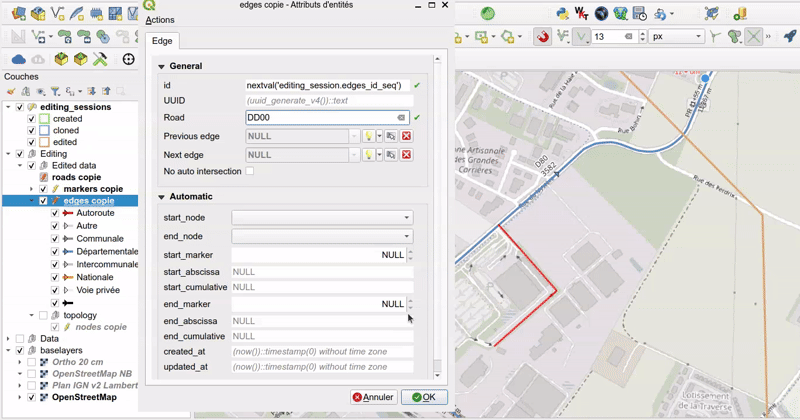

# Road graph editing

## Editing rules

The road graph data are **not edited directly** in the production schema `road_graph`,
but in a **dedicated editing session schema** `road_graph_editing`, which acts as a sandbox:

1. The user **draws a polygon** in the `editing_sessions` layer around the area to edit.
   The new editing session has the status `created`.
2. The algorithm `Clone data to a new editing session` (toolbar button `Clone data to the editing sandbox`)
   **copies an extract of the production data** inside this polygon into the sandbox.
   The status becomes `cloned`.
3. The **editing** is made with the **QGIS tools**: forms, topological editing, etc.
   The status becomes `edited` after the first change.
    * QGIS **automatic transaction grouping** is activated in the project:
      the changes made by the database triggers (node creation, edge split, etc.) are visible **live**.
    * A layer action helps to **create roundabouts**, see [Create a roundabout](#create-a-roundabout).
4. The algorithm `Merge editing session data` (toolbar button `Merge editing sandbox data`)
   **merges the modifications back** into the `road_graph` schema
   and updates the [managed objects](managed-objects.md).
   The sandbox data and the merged editing session are then deleted.

## Create a roundabout

Roundabouts have their own road code, e.g. `GIR_D40_D80`, and cut the other roads
(see [Concepts](../concepts/index.md#corner-cases)).
The road of the roundabout must exist in the `roads` layer with the road type `roundabout`.

To create a roundabout in the editing session:

1. **Toggle editing** on the edges layer.
2. Use the QGIS shape digitizing tool `Circle by a center point and another point`
   to draw the roundabout circle, and give it the road code of the roundabout.
3. Once the circle is created, the database **trigger functions** automatically **split the circle into edges**
   at each intersection with the edges of the existing crossroads.
4. Right-click on one of the edges of the roundabout circle with the `Identify Features` tool,
   and choose the action `Finalize the roundabout`.

This QGIS Python action runs the database function `clean_digitized_roundabout`, which:

* **deletes the pieces of edges inside the roundabout**, and updates the previous and next edges of the remaining roads,
* **deletes the node** created by QGIS at the **top of the circle**, by merging the two edges around it,
* **adds a marker `0`** for this roundabout, on its westernmost node, if it does not already exist.

The action is cancelled with a warning if the layer is not in editing mode,
or if the road type of the selected edge is not `roundabout`.
You may have to refresh the map canvas to see the changes.

## How to edit the data in QGIS

In QGIS, you can edit the layer data by toggling the **editing mode** for each layer:

* **Select the layer** in the panel by clicking on it: the layer is highlighted in blue
* **Right-click on the layer name** and select `Toggle Editing` or use the menu `Layer / Toggle Editing`

To **add a new record**, select the layer in the `Layers` panel,
then use the menu `Edit / Add Record` (or `CTRL+.`). It will open a form which lets you enter the needed data.
Once every required fields have been filled, validate with the `OK` button on the bottom-right.

To **view all the records** of a layer, select the layer in the `Layers` panel,
then open the attribute table with the menu `Layer / Open Attribute Table` (or `F6`)

You can **undo previous modifications** with the menu `Edit / Undo` (or `CTRL+Z`).

To permanently **save the changed data** in the layer, you need to use the menu `Layer / Save Layer Edits`.
After saving the data, you will not be able to undo your changes
(but you can always reopen the data and changed the values).

To **edit a record**, open the layer attribute table, and then click on the small button `Switch to form view`
on the bottom-right of the dialog (the first one). Then select a record in the left panel,
and use the displayed form to edit the data.

To **delete a record**, select the record in the attribute table by clicking on the line number on the left:
the line must be highlighted in blue. Then use the trash icon `Delete selected features` (or `Del`).
*You can undo the deletion if you have not yet saved layer edits*.
