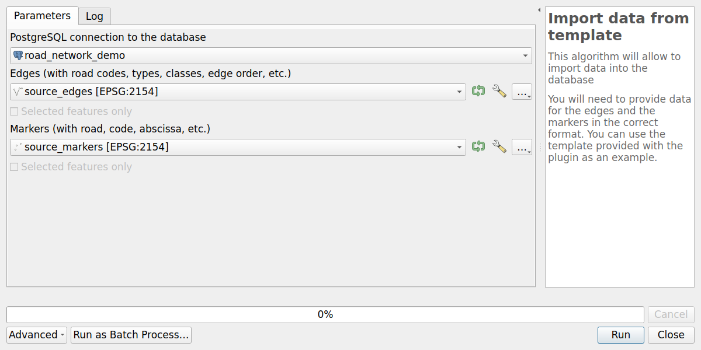

# Import data

## Import the road graph: edges and markers

The road graph tables `roads`, `edges`, `nodes` and `markers` can be filled from two vector layers:
one for the **edges** and one for the **markers**.

These layers must follow the structure of the template files provided with the plugin,
in the folder `roadnetwork/resources/import/` of the plugin:

* `source_edges.fgb` for the edges,
* `source_markers.fgb` for the markers.

You can open these [FlatGeobuf](https://flatgeobuf.org/) files in QGIS to see example data.

### Edges layer

Each feature is an **edge**, i.e. a portion of a road between two nodes, drawn in the direction of the road.

* Geometry: **LineString**, or MultiLineString with **only one part**
  (only the first part of a multi-part geometry is imported).
* Columns:

| Column            | Type    | Description                                                                         |
|-------------------|---------|-------------------------------------------------------------------------------------|
| `road_code`       | text    | Code of the road, e.g. `D248`. The roads are created from the distinct values.      |
| `edge_order`      | integer | Order of the edge in its road, from the start of the road: `1`, `2`, `3`, etc.      |
| `road_type`       | text    | `road` or `roundabout`                                                              |
| `road_class`      | text    | Class of the road. It must exist in the table `glossary_road_class`, e.g. `Départementale` |
| `road_class_code` | text    | Code of the road class, e.g. the code of the French department                      |
| `is_active`       | boolean | If the road is active                                                               |
| `road_topic`      | text    | Optional topic of the road, e.g. `Port`. Can be empty.                              |
| `is_access_road`  | boolean | If the road is an access road                                                       |
| `id_source`       | text    | Identifier of the feature in the source data. Can be empty.                         |

The `previous` and `next` edges of each edge are calculated from the `edge_order` column.

### Markers layer

Each feature is a **marker** (reference point, PR) positioned along a road.

* Geometry: **Point**, or MultiPoint with **only one point**.
* Columns:

| Column       | Type    | Description                                                                                  |
|--------------|---------|----------------------------------------------------------------------------------------------|
| `road_code`  | text    | Code of the road of the marker. It must correspond to a `road_code` of the edges layer.      |
| `code`       | integer | Code of the marker, e.g. `12` for `PR 12`. Must be positive.                                 |
| `abscissa`   | real    | Abscissa of the marker, in meters. Must be positive. Use `0` for the real markers.           |
| `is_virtual` | boolean | `True` for a [virtual marker](../concepts/index.md#glossary), `False` for a real marker.     |
| `id_source`  | text    | Identifier of the feature in the source data. Can be empty.                                  |

A marker `0` with an abscissa `0` is automatically created at the start of each road, if it does not already exist.

### Run the import

Use the Processing algorithm `Import data from template`, also available with the button `Import data`
of the RoadNetwork administration panel:

* `PostgreSQL connection to the database`: the database where the plugin structure has been installed,
* `Edges`: the edges layer,
* `Markers`: the markers layer.



The algorithm:

1. checks that the layers contain the required columns,
2. copies the layers in temporary tables, reprojected to the coordinate reference system of the database,
3. runs the database function `road_graph.import_data_from_template_tables`, which:
    * checks the values of `road_type` and `road_class`,
    * creates the **roads**, the **nodes** at the start and end of each edge, the **edges** and the **markers**,
    * calculates the **references** of the edges (start and end markers, abscissas and cumulative distances),
4. displays the number of imported roads, edges, nodes and markers, and drops the temporary tables.

!!! note
    This import is designed to **initialize an empty road graph**.
    Existing objects are not updated: conflicting data are ignored.

## Import the managed objects

The **managed objects** are the business data based on the road network,
such as road signs, trees or safety barriers (see [Managed objects](managed-objects.md)).
They are stored in your own PostgreSQL tables.

### Prepare the table

The table must have:

* a **primary key**,
* a **geometry** column `geom`, in the same coordinate reference system as the road graph,
  of type **Point** for point objects, or **LineString** / **MultiLineString** for linear objects,
* a text column `road_code`,
* the **reference columns**, which are calculated from the road graph:

| Geometry type   | Required columns                                                                     | Optional columns                                        |
|-----------------|--------------------------------------------------------------------------------------|---------------------------------------------------------|
| Point           | `marker_code` (integer), `abscissa` (real)                                           | `cumulative` (real), `offset` (real), `side` (text)     |
| (Multi)LineString | `start_marker_code` (integer), `start_abscissa` (real), `end_marker_code` (integer), `end_abscissa` (real) | `start_cumulative`, `end_cumulative` (real), `offset` (real), `side` (text) |

For example, for a table of trees:

```sql
CREATE TABLE managed.demo_trees (
    id integer PRIMARY KEY GENERATED BY DEFAULT AS IDENTITY,
    species text NOT NULL,
    road_code text,
    marker_code integer,
    abscissa real,
    side text,
    "offset" real,
    cumulative real,
    geom geometry(POINT, 2154)
);
```

Then import your data into this table, for example with the QGIS tools
(drag and drop in the `Browser` panel, `Database / DB Manager`, or the Processing algorithm
`Export to PostgreSQL`), or with SQL.

### Register the table

Add the table in the `managed_objects` layer (table `road_graph.managed_objects`),
with its schema name, table name, geometry type and update policy:

```sql
INSERT INTO road_graph.managed_objects (
    schema_name, table_name, geometry_type, update_policy_on_graph_change
)
VALUES ('managed', 'demo_trees', 'POINT', 'references');
```

### Calculate the references

Once the features have been imported, calculate their **references** from their geometries
with the database function `road_graph.update_table_references_from_geometries`:

```sql
-- Calculate the references of all the features of the table
SELECT road_graph.update_table_references_from_geometries('managed', 'demo_trees', NULL);

-- Calculate the references of the features of some roads only
SELECT road_graph.update_table_references_from_geometries('managed', 'demo_trees', ARRAY['D138', 'D152']);
```

The function parameters are the schema name, the table name, and an optional list of road codes.
For each feature:

* if the column `road_code` is filled, the references are calculated **on this road**,
* if it is empty, the **closest road** is used, and the column `road_code` is filled.

It returns the number of updated features and their ids, for example:

```json
{"nb": 7, "last_updated_objects_ids": [1, 2, 3, 4, 5, 6, 7]}
```

If your data contain the **references but no geometry**, use instead the function
`road_graph.update_table_geometries_from_references`, with the same parameters,
to calculate the geometries from the references.

### Keep the references up to date

To calculate automatically the references of the features created or moved afterwards,
check the column `add_trigger_on_geom_change` of the table in the `managed_objects` layer,
and create the trigger with the function `road_graph.add_managed_objects_triggers()`.
See [Automatic calculation of the references](managed-objects.md#automatic-calculation-of-the-references).
