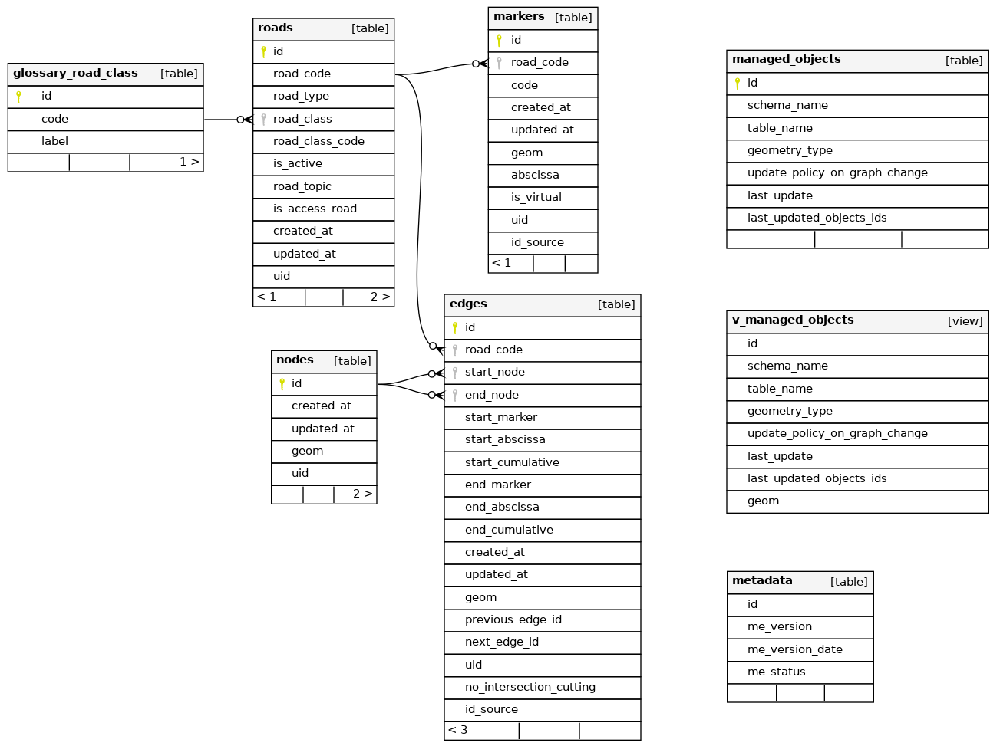
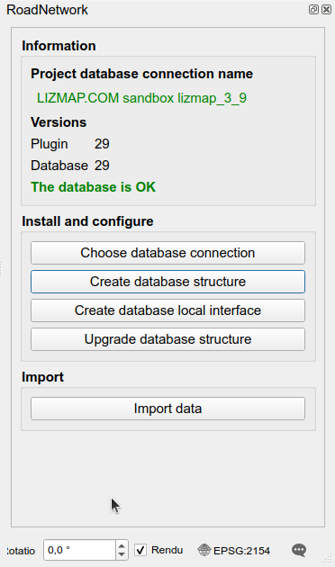

# User guide

The RoadNetwork plugin stores all the business logic **inside a PostgreSQL database**.
The QGIS plugin helps to create and upgrade this database, to visualize the road network,
to edit it safely and to keep the business data up to date.

This guide is split in five parts:

* [Import data](import.md): how to import the road graph (edges and markers) into the database,
  and how to create a demo database.
* [QGIS project and tools](qgis-project.md): the administration project, the toolbar and panels of the plugin,
  and the tools available to search and get references.
* [Processing algorithms](processing.md): the algorithms provided by the plugin.
* [Road graph editing](graph-editing.md): how to edit the roads, edges and markers
  in a dedicated editing session.
* [Managed objects](managed-objects.md): how to prepare the business data based on the road network,
  and how they are kept up to date when the graph changes.

## Database model

All the logic is stored inside a **PostgreSQL database**:

* a simple set of **tables**: `roads`, `edges`, `nodes`, `markers`, `glossary_road_class`,
  `managed_objects`, and some **views**,
* many **functions** to calculate references and geometries, among them:
    * `get_road_point_from_reference`
    * `get_road_substring_from_references`
    * `update_table_references_from_geometries`
    * `update_table_geometry_from_references`
* **trigger functions** in charge of maintaining the road network **topology**:
  automatic node creation, split of intersected edges, etc.

See [Tables and fields](../database-guide/tables.md) for the description of the fields of the tables,
and the [Database structure](../database-guide/structure.md) documentation for a complete description of the tables and functions.

## Administration tools

The plugin provides **QGIS Processing algorithms** which allow to:

* **create the database structure** with all the tables, functions, etc.: `Create database structure`,
* **upgrade the structure** automatically when upgrading the plugin: `Upgrade database structure`,
* **create a QGIS administration project** with all the layers, styles, labels, actions, etc.:
  `Create database local interface`,
* **import data** from template **edges** and **markers** tables: `Import data from template`.

These algorithms, described in [Processing algorithms](processing.md),
are available in the QGIS Processing toolbox and in the **RoadNetwork administration panel**,
which also shows the database connection used by the project and checks
that the plugin and database versions match.

