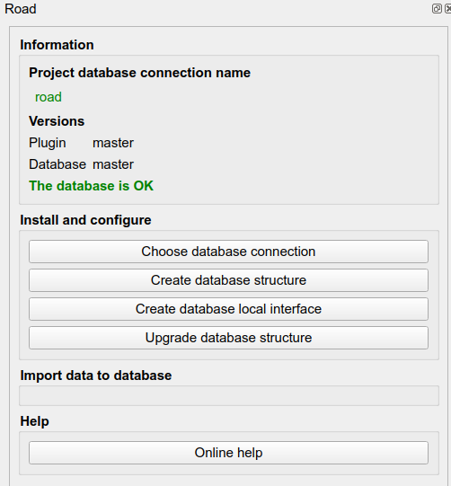

# Lizmap Web Client tools

The road network can be published with [Lizmap Web Client](https://docs.lizmap.com/) (LWC).
A JavaScript script, [road_network.js](../media/road_network.js), adds tools to the web map
so that users can work with **linear references** (road, marker, abscissa, offset and side)
directly in the browser.

These tools rely on [Lizmap actions](https://docs.lizmap.com/current/en/publish/configuration/action_popup.html):
each tool calls a named action, which runs the PostgreSQL function `lizmap_get_data(json)`.
This function calls the `road_graph` functions of the plugin
and returns the result as GeoJSON.

!!! note
    The user interface is written in English and can be [translated](#translate-the-interface).
    This page gives the labels of the French interface, with the English text.

## Features

The script adds four tools:

| Tool | Where | Lizmap actions used |
|------|-------|---------------------|
| [Road network panel](#road-network-panel) | Mini-dock *Graphe routier* | `get_references_from_point`, `get_road_point_from_reference` |
| [Create a geometry from references](#create-a-geometry-from-references) | Editing form | `get_references_from_point`, `get_road_point_from_reference`, `get_road_substring_from_references`, `get_edge_start_or_end_tip_from_references` |
| [Split a line](#split-a-line-at-a-point) | Feature popup | `split_line_by_point` |
| [Merge two lines](#merge-two-lines) | Feature popup | `merge_selected_lines` |

### Road network panel

The script adds a mini-dock named **Graphe routier** (*Road network*).
It opens when the map loads.



The panel contains a form with these fields:

| Label | Meaning |
|-------|---------|
| Route | Road code, for example `D1`. The list of values comes from the `roads` layer. |
| PR | Marker code (in French: *point de repère*) |
| Abscisse | Abscissa: distance in meters from the marker |
| Cumul | Cumulative distance in meters from the start of the road (read-only) |
| Décalage | Offset: distance in meters from the road axis |
| Côté | Side of the road: *Gauche* (left) or *Droite* (right) |

#### Get the references of a point

When the panel is open, **click on the map**. The script runs the action
`get_references_from_point` with the clicked point. The returned references
fill the form, and the point is displayed on the map.

#### Show the references when hovering the map

Check **Activer le calcul au survol** (*Enable calculation on hover*).
When the mouse moves over the map, a tooltip displays the references
of the point under the cursor, for example `D1 - PR 3 + 250m (2m G)`.
The values in the form are updated too.

To limit the number of requests to the server:

* the script sends at most one request every 200 ms,
* no request is sent while the user drags the map.

This option is not available while the editing form is open.

#### Center the map on references

Type a road, a marker, an abscissa, an offset and a side in the form,
then click **Centrer** (*Center*). The script runs the action
`get_road_point_from_reference` and centers the map on the returned point.

!!! tip
    Click and hover only work at scale 1:50,000 or larger. At a smaller scale,
    a message asks the user to zoom in.

### Create a geometry from references

When the user opens the Lizmap editing form for a **point** or **line** layer,
the script adds a collapsible section above the form:
**Créer la géométrie depuis des références** (*Create the geometry from references*).

The fields depend on the geometry type of the layer:

* **Point layer**: road, marker, abscissa, offset and side.
* **Line layer**: road, start marker and abscissa (*PR début*, *Abscisse début*),
  end marker and abscissa (*PR fin*, *Abscisse fin*), offset and side.

If the editing form has a field named `road_code`, its value is copied
into the **Route** field.

#### Buttons

| Button | Action |
|--------|--------|
| **Créer** (*Create*) | Computes the geometry from the references and replaces the geometry of the edited feature. For a point layer, the script runs `get_road_point_from_reference`. For a line layer, it runs `get_road_substring_from_references`. If the start references are after the end references, the script swaps them. |
| **Réinitialiser** (*Reset*) | Deletes the drawn geometry and resets the reference fields. |
| **Tronçon** (*Edge*), start row | Sets the start references to the start of the edge located at the start references. |
| **Route** (*Road*), start row | Sets the start references to the start of the road. |
| **Tronçon** (*Edge*), end row | Sets the end references to the end of the edge located at the end references. |
| **Route** (*Road*), end row | Sets the end references to the end of the road. |

The **Tronçon** and **Route** buttons are only available for line layers.
They run the action `get_edge_start_or_end_tip_from_references`.
After that, the line geometry is computed again.

#### Snap a drawn geometry to the road

When the user draws or modifies the geometry with the Lizmap drawing tools,
the script:

1. runs `get_references_from_point` for the point, or for the first and last
   vertices of the line,
2. fills the reference fields with the returned values,
3. replaces the drawn geometry with the geometry computed from these references.

As a result, the geometry always follows the road. If the road field has a value,
only this road is used to find the references.

If no reference is found after 2 seconds, a message tells the user that the
geometry could not be created. The most common cause is a point more than
50 m away from the road.

When the feature is saved, the **Graphe routier** panel opens again.

### Split a line at a point

This tool adds a button to the popup of the features of a line layer.
It splits a line in two features at a point.

The button is only displayed if the user can **modify the geometry** and
**create features** in this layer, in the Lizmap editing configuration.

1. Open the **Graphe routier** panel and click on the line where it must be split.
   A red point is displayed on the map.
2. In the popup of the line, click the button. Its label is the `title`
   of the `split_line_by_point` action.
3. Confirm the operation.

The script sends the red point to the action `split_line_by_point`.
The database function `road_graph.split_table_linestring_feature_by_point`
splits the line, and the layer is refreshed.

The default popup button of this action is hidden, because it does not send
the clicked point.

### Merge two lines

This tool adds a button to the popup of the features of a line layer.
It merges two features of the same layer into one feature.

The button is only displayed if the user can **modify the geometry** and
**delete features** in this layer, in the Lizmap editing configuration.

1. In the popup of the first line, click **Choisir cet objet pour fusion**
   (*Choose this feature to merge*). The button label becomes
   **Objet choisi pour la fusion** (*Feature chosen to merge*).
   To cancel, click this button again.
2. Click on the second line on the map. In its popup, click
   **Fusionner avec l'objet choisi** (*Merge with the chosen feature*).
3. Confirm the operation.

The script runs the action `merge_selected_lines` with the IDs of the two features.
The database function `road_graph.merge_table_linestring_features` merges them
and the layer is refreshed. The popup then shows only the merged feature.

Once a first feature is chosen, the merge button is only displayed for features
of the same layer.

## Installation

### 1. Publish the layers

In the QGIS project:

* add the `road_graph.edges` layer. The actions about references use this layer.
* add the `road_graph.roads` layer and publish it as **WFS**
  (*Project properties* > *QGIS Server* > *WFS capabilities*).
  The script uses it to fill the list of roads. The layer must have
  the fields `id`, `road_code` and `road_order`.
* for the split and merge tools, add the line layers that the users can edit.

### 2. Create the database function

Create the function `public.lizmap_get_data(json)` in the database.
The file [lizmap_get_data_example.sql](../media/lizmap_get_data_example.sql)
gives a complete example for all the actions.

The function uses the projection `EPSG:2154`. Change it if your data uses
another projection.

### 3. Create the actions file

Create a file named after the QGIS project, with the extension `.action`.
For example, for `road_network.qgs`, create `road_network.qgs.action`
in the same folder.

The file [lizmap_action_file_example.json](../media/lizmap_action_file_example.json)
gives a complete example. Update it:

* replace `edges_7df8a321_25e8_4a67_9bf8_796e4782e147` with the ID of your `edges` layer,
* replace `demo_painting_26eb3c57_3374_41a5_8628_391caa42f33a` with the IDs of the
  line layers for the split and merge tools. Do this in `layers` and in `callbacks`.

The action names must not change, because the script uses them.

| Action | Scope | Options | Returned feature |
|--------|-------|---------|------------------|
| `get_references_from_point` | `layer` | `road_code`, `vertex_number` | Point with `road_code`, `marker_code`, `abscissa`, `cumulative`, `offset`, `side`, `vertex_number` |
| `get_road_point_from_reference` | `layer` | `road_code`, `marker_code`, `abscissa`, `offset`, `side` | Point with the references |
| `get_road_substring_from_references` | `layer` | `road_code`, `start_marker_code`, `start_abscissa`, `end_marker_code`, `end_abscissa`, `offset`, `side` | Multilinestring with the start and end references |
| `get_edge_start_or_end_tip_from_references` | `layer` | `road_code`, `marker_code`, `abscissa`, `start_or_end` (`start` or `end`), `tip_type` (`edge` or `road`) | Point with `marker_code`, `abscissa`, `start_or_end` |
| `split_line_by_point` | `feature` | none (the clicked point is sent as WKT) | The clicked point, `message` and `message_detail` |
| `merge_selected_lines` | `layer` | `feature_id_a`, `feature_id_b` | `message` and `message_detail`, no geometry |

`vertex_number` tells the script where to put the result:
`-1` for the panel, `0` for the start point and `1` for the end point
of the edited geometry.

### 4. Configure the script

Open [road_network.js](../media/road_network.js) and edit the
`CONFIGURATION` section at the top of the file:

| Constant | Default value | Description |
|----------|---------------|-------------|
| `ROAD_MIN_SCALE` | `50000` | Smallest scale denominator for the click and hover tools |
| `ROAD_ROADS_LAYER_NAME` | `roads` | WFS name of the `roads` layer |
| `ROAD_EDGES_LAYER_ID` | `edges_7df8a321_...` | QGIS ID of the `edges` layer |
| `ROAD_ORDER_FIELD` | `road_order` | Field used to sort the list of roads |

Do not edit the code below the `END CONFIGURATION` comment.

### 5. Add the files to Lizmap

Follow the Lizmap documentation:
[Adding your own JavaScript](https://docs.lizmap.com/current/en/publish/customization/javascript.html).

1. Allow JavaScript for the repository in the Lizmap administration
   (*Allow themes/JavaScript codes for this repository*).
2. Copy [road_network.js](../media/road_network.js),
   [road_network.css](../media/road_network.css) and
   [road_network.csv](../media/road_network.csv) into the repository folder:
    * `media/js/<project_name>/` to use the tools in one project,
    * `media/js/default/` to use them in all projects of the repository.
3. Reload the map in the browser.

## Translate the interface

The texts of the interface are written in English in the script.
The translations are stored in a CSV file located next to the script.
This file has the same name as the script, with the `.csv` extension:
`road_network.csv` for `road_network.js`.

When the map loads, the script:

1. gets the language of the user interface, from the `lang` attribute of the page
   or from the browser language,
2. downloads the CSV file,
3. displays the translated texts. A text without a translation is displayed in English.

If the CSV file is not found, the interface is displayed in English.

The first line of the file contains the language codes. The first column
contains the English text, exactly as written in the script.
Each other column contains the translations for one language:

```csv
en,fr
Road network,Graphe routier
Road,Route
"Please zoom in to at least 1:{scale} to display the references","Veuillez zoomer au moins au 1/{scale} pour afficher les références"
```

To add a language, add a column with its two-letter code, for example `de` or `es`.

Rules for the values:

* enclose a value in double quotes if it contains a comma, a double quote or a new line,
* double the double quotes inside a value: `""`,
* keep the placeholders in braces, for example `{scale}`, and do not translate them.
  They are replaced by values when the text is displayed. They can be moved in the sentence.

### Texts of the actions and of the database

The same CSV file also translates:

* the `title` and `confirm` properties of the actions, in the `.qgs.action` file.
  Write them in English, and add them to the CSV file.
* the messages returned by the `lizmap_get_data` function, in the `message` field.
  Lizmap displays them at the top of the map, and the script replaces them
  by their translation.

A message can contain a variable part, for example the detail of an error
returned by the database. In this case, the `lizmap_get_data` function must also return
this variable part in a `message_detail` field, and the message must end with it:

| Field | Value |
|-------|-------|
| `message` | `An error occurred while splitting the line: The point is not close enough to the feature (distance 12 > 5m)` |
| `message_detail` | `The point is not close enough to the feature (distance 12 > 5m)` |

In the CSV file, the variable part is replaced by the `{detail}` placeholder:

```csv
"An error occurred while splitting the line: {detail}","Une erreur s'est produite lors de la découpe de la ligne : {detail}"
```

The variable part itself is not translated.

If you change a text in the `.qgs.action` file or in the `lizmap_get_data` function,
change it in the CSV file too. Otherwise, the text is displayed without translation.

## Limitations

* The script was written for a specific version of Lizmap Web Client.
  It may not work with another version.
* The tools only support **point** and **line** layers.
* The start and end references of a line must be on the same road.
* The split and merge tools are not available for the `edges` layer.
