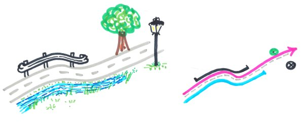

# Managed objects

The **local authorities** manage a lot of data based on the road network:
roadworks, asphalt rehabilitation, road signs, hedge pruning, etc.

Each data object, **point** or **(multi)linestring**, is defined by its **references**
calculated from the road network (see [Concepts](../concepts/)).
When the road graph is modified, these objects must be updated.



## The managed objects layer

The `managed_objects` layer lists **all the PostgreSQL tables** impacted by any **graph modification**,
with the update policy to apply to each of them:

| id | schema_name | table_name           | geometry_type   | update_policy_on_graph_change | add_trigger_on_geom_change |
|----|-------------|----------------------|-----------------|-------------------------------|----------------------------|
| 1  | managed     | demo_trees           | POINT           | references                    | True                       |
| 2  | managed     | demo_safety_barriers | MULTILINESTRING | geometry                      | False                      |

* `schema_name` and `table_name`: the business table,
* `geometry_type`: the geometry type of the table, e.g. `POINT` or `MULTILINESTRING`,
* `update_policy_on_graph_change`: the rule chosen by the administrator:
    * `references`: the geometry is kept and the **references are updated**,
    * `geometry`: the references are kept and the **geometry is updated**.
* `add_trigger_on_geom_change`: if `True`, the trigger calculating the references
  is created on this table by the function `road_graph.add_managed_objects_triggers()`
  (see [below](#automatic-calculation-of-the-references)). Default: `False`.

## Last updated objects

The layer `vm_managed_objects` shows, for each managed table, the **objects updated by the last merge**
of an editing session, as a 10m buffer around them. It is useful to have a quick look at the impacted objects.

This layer is a **materialized view** based on the view `road_graph.v_managed_objects`,
which can be slow to compute. It is **refreshed automatically at the end of the merge**
of an editing session. To refresh it manually, for example after running the algorithm
`Update managed objects from the road graph`, use:

```sql
REFRESH MATERIALIZED VIEW road_graph.vm_managed_objects;
```

## Automatic calculation of the references

The trigger function `road_graph.calculate_managed_object_references` **calculates the references**
of a managed object feature each time it is **inserted** or its **geometry is updated**.
The table must be listed in `road_graph.managed_objects`, and have a `road_code` and a `geom` column.

The function `road_graph.add_managed_objects_triggers()` creates this trigger, named
`trg_calculate_managed_object_references`, on **every table** listed in `road_graph.managed_objects`
with the column `add_trigger_on_geom_change` set to `True`.
Run it after adding new tables in the managed objects layer, or after checking this column:

```sql
SELECT * FROM road_graph.add_managed_objects_triggers();
```

It can be run several times: the trigger is only created when it does not already exist.
Unchecking `add_trigger_on_geom_change` does not remove an existing trigger.
The function returns one line per managed object, with its trigger status:

| schema_name | table_name    | trigger_status        |
|-------------|---------------|-----------------------|
| public      | demo_painting | created               |
| public      | demo_trees    | already exists        |
| public      | demo_nogeom   | geom column not found |
| public      | missing_table | table not found       |
| public      | demo_signs    | not requested         |

For each table, the created trigger is equivalent to:

```sql
CREATE TRIGGER trg_calculate_managed_object_references
BEFORE INSERT OR UPDATE OF geom
ON public.demo_painting
FOR EACH ROW EXECUTE PROCEDURE road_graph.calculate_managed_object_references();
```

## Update rules

When the user **merges the data from the editing session**, every impacted object is
**automatically updated based on the rule** chosen by the administrator:

* **Point objects** are often not moved, but their **references must be updated**, e.g. a road sign.
* **(Multi)linestring objects** must often follow the changes: the start and end points are kept
  and only the nodes in between are edited, e.g. a painting roadwork.

The algorithm `Update managed objects from the road graph` can also be run manually on a given layer,
with the following parameters:

* `Update policy`: `Update geometries` or `Update references`,
* `Update geometries - Preserve start & end points when updating line geometries`: `No` or `Yes`.
