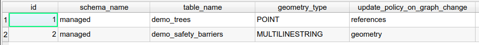

# Managed objects

The **local authorities** manage a lot of data based on the road network:
roadworks, asphalt rehabilitation, road signs, hedge pruning, etc.

Each data object, **point** or **(multi)linestring**, is defined by its **references**
calculated from the road network (see [Concepts](../concepts/)).
When the road graph is modified, these objects must be updated.

## The managed objects layer

The `managed_objects` layer lists **all the PostgreSQL tables** impacted by any **graph modification**,
with the update policy to apply to each of them:

* `schema_name` and `table_name`: the business table,
* `geometry_type`: the geometry type of the table, e.g. `POINT` or `MULTILINESTRING`,
* `update_policy_on_graph_change`: the rule chosen by the administrator:
    * `references`: the geometry is kept and the **references are updated**,
    * `geometry`: the references are kept and the **geometry is updated**.

## Update rules

When the user **merges the data from the editing session**, every impacted object is
**automatically updated based on the rule** chosen by the administrator:

* **Point objects** are often not moved, but their **references must be updated**, e.g. a road sign.
* **(Multi)linestring objects** must often follow the changes: the start and end points are kept
  and only the nodes in between are edited, e.g. a painting roadwork.

The algorithm `Update managed objects from the road graph` can also be run manually on a given layer,
with the following parameters:

* `Update policy`: `Update geometries` or `Update references`,
* `Update geometries - Preserve start & end points when updating line geometries`: `No` or `Yes`.
