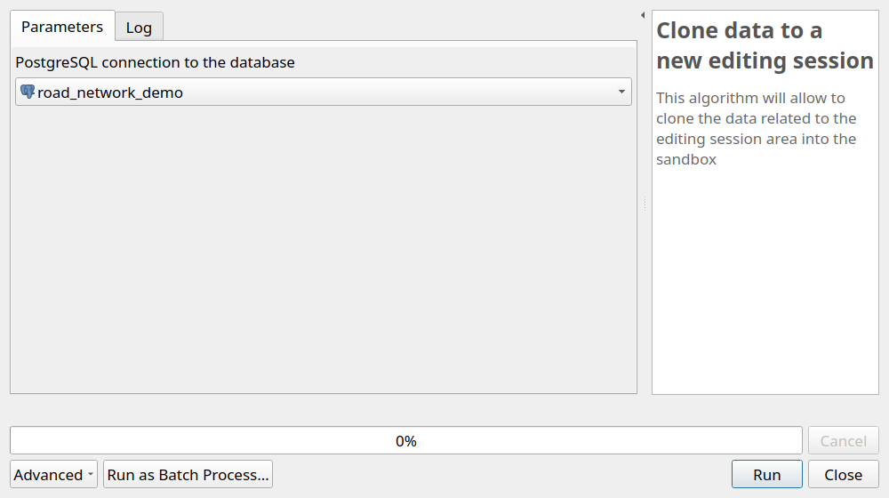
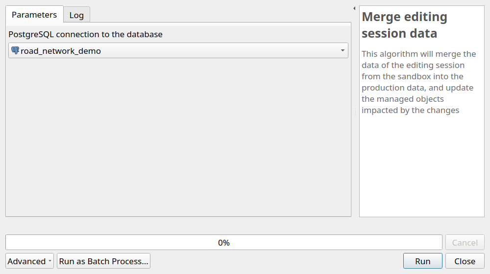
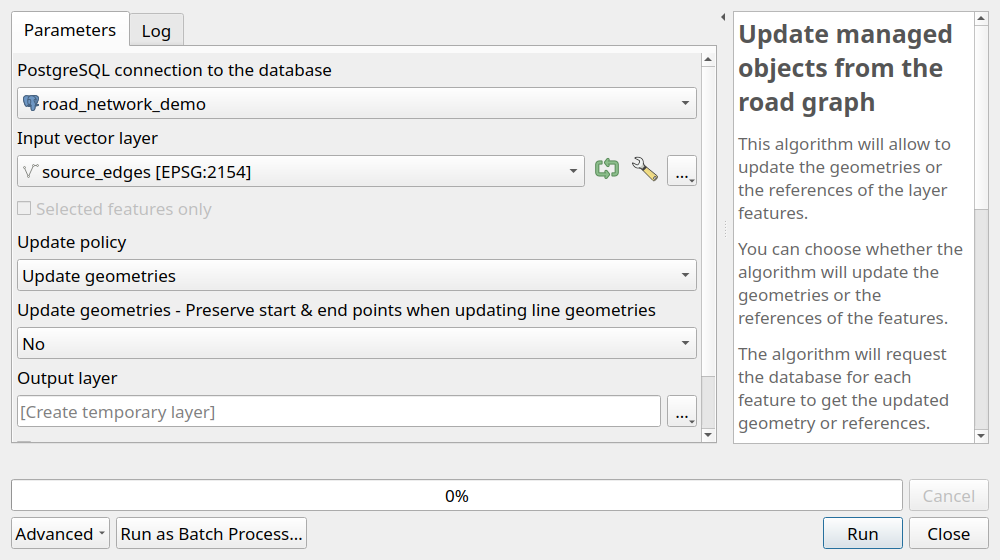
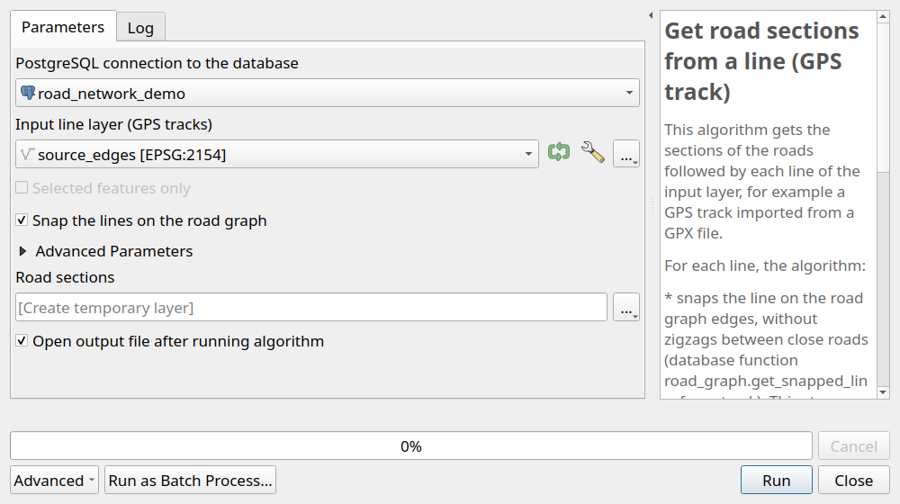

# Processing algorithms

The plugin adds the provider **RoadNetwork** to the QGIS **Processing toolbox** (menu `Processing / Toolbox`).
Most of the algorithms are also available with the buttons of the [toolbar and panels](qgis-project.md#toolbar-menu-and-panels).

| Group | Algorithm | Usage |
|-------|-----------|-------|
| Configuration | [Configure plugin](#configure-plugin) | Choose the PostgreSQL connection of the project |
| Structure | [Create database structure](#create-database-structure) | Install the schema `road_graph` in the database |
| Structure | [Upgrade database structure](#upgrade-database-structure) | Upgrade the schema after a plugin upgrade |
| Administration | [Create database local interface](#create-database-local-interface) | Create the QGIS administration project |
| Editing | [Import data from template](#import-data-from-template) | Fill an empty road graph from edges and markers layers |
| Editing | [Clone data to a new editing session](#clone-data-to-a-new-editing-session) | Copy the data of an editing session area into the sandbox |
| Editing | [Merge editing session data](#merge-editing-session-data) | Merge the sandbox data into the production data |
| Editing | [Update managed objects from the road graph](#update-managed-objects-from-the-road-graph) | Calculate the references from the geometries, or the geometries from the references, of a layer |
| Linear referencing | [Get road sections from a line (GPS track)](#get-road-sections-from-a-line-gps-track) | Get the sections of the roads followed by lines, for example GPS tracks |

All the algorithms have a parameter `PostgreSQL connection to the database`:
by default, the connection chosen with the algorithm `Configure plugin`.

## Configuration

### Configure plugin

Choose the **PostgreSQL connection** used by the current QGIS project.
It must be run before the other algorithms.
See [Configure the plugin](../installation/index.md#configure-the-plugin).

## Structure

### Create database structure

Install the schema `road_graph`, with its tables, views and functions, and the editing schema `road_graph_editing`.
See [Create the database structure](../installation/index.md#create-the-database-structure).

### Upgrade database structure

Upgrade the database structure to the version of the plugin, after a plugin upgrade.
The administration panel shows if an upgrade is needed.
See [Upgrade database structure](../installation/index.md#upgrade-database-structure).

## Administration

### Create database local interface

Create a **QGIS administration project** with all the layers, styles, labels and actions.
See [Create your database local interface](../installation/index.md#create-your-database-local-interface)
and [Administration project](qgis-project.md#administration-project).

## Editing

### Import data from template

Fill an **empty road graph** from an edges layer and a markers layer.
The roads, nodes, edges and markers are created, and the references of the edges are calculated.
See [Import the road graph](import.md#import-the-road-graph-edges-and-markers).

### Clone data to a new editing session

Copy the production data located inside the **last editing session polygon** with the status `created`
into the editing schema `road_graph_editing`, the sandbox. The status of the session becomes `cloned`.

Also available with the toolbar button `Clone data to the editing sandbox`
and with the action `Create editing session` of the `editing_sessions` layer.

The algorithm refuses to run if:

* the `editing_sessions` layer is in editing mode: save the changes and stop the editing beforehand,
* an editing session with the status `edited` has not been merged or dropped yet,
* there is no editing session with the status `created`: draw the editing session polygon beforehand.

See [Road graph editing](graph-editing.md#editing-rules).

### Merge editing session data

Merge the data of the **editing session with the status `edited`** into the production schema `road_graph`,
update the [managed objects](managed-objects.md#update-rules) impacted by the changes,
then empty the sandbox and delete the merged editing session.

Also available with the toolbar button `Merge editing sandbox data`.

The algorithm refuses to run if the `editing_sessions` layer cannot be found or is in editing mode,
or if there is no editing session with the status `edited`.

See [Road graph editing](graph-editing.md#editing-rules).

### Update managed objects from the road graph

Update the **references** or the **geometries** of the features of a vector layer from the road graph.
The layer can be a PostgreSQL table of the database, or any other vector layer, for example a GeoPackage layer.

Parameters:

* `Input vector layer`: a point or (multi)linestring layer,
* `Update policy`:
    * `Update references`: the references of each feature are calculated from its geometry,
    * `Update geometries`: the geometry of each feature is calculated from its references,
* `Update geometries - Preserve start & end points when updating line geometries`: `No` or `Yes`.
  Used only to update the geometries of a line layer:
    * `No`: the geometry is calculated from the **stored references**,
    * `Yes`: the references are first calculated from the **start and end points** of the line,
      then the geometry is calculated from them. The line keeps its start and end points,
      and follows the road between them. Use it when the start and end points are right
      but the references are outdated or the line does not follow the road,
* `Output layer`: the layer created with the updated features.

The input layer must have the **reference fields** corresponding to its geometry type:

* point layers: `road_code`, `marker_code`, `abscissa`, and optionally `offset`, `side` and `cumulative`,
* linestring layers: `road_code`, `start_marker_code`, `start_abscissa`, `end_marker_code`, `end_abscissa`,
  and optionally `offset` and `side`.

The algorithm supports the **in-place editing** of the input layer: select the layer, toggle its editing mode,
then use the button `Edit Features In-Place` of the Processing toolbox.
The features are then updated directly in the layer, and the changes can be checked before saving them.

For the tables registered in the `managed_objects` layer, the same updates can be done with SQL,
see [Calculate the references](managed-objects.md#calculate-the-references).
They are also done automatically when an editing session is merged, see [Update rules](managed-objects.md#update-rules).

## Linear referencing

### Get road sections from a line (GPS track)

Get the **sections of the roads** followed by each line of a layer, for example **GPS tracks** imported
from GPX files, with the **start and end references** of each road.

For each line, the algorithm:

1. **snaps the line on the road graph edges**, without zigzags between close roads,
   with the database function `road_graph.get_snapped_line_from_track`,
2. gets the **ordered list of the roads** followed by the snapped line, with the database function
   `road_graph.get_road_sections_from_snapped_line`.

See [GPS tracks](../database-guide/functions.md#gps-tracks-from-a-gpx-file-to-the-road-references)
for the details of these functions.

Parameters:

* `Input line layer (GPS tracks)`: a line or multiline layer, in any coordinate reference system.
  For a GPX file, open its layer `tracks`,
* `Snap the lines on the road graph`: checked by default. Uncheck it only if the lines already follow
  the road graph edges, for example the result of a previous snapping,
* advanced parameters, used to snap the lines:
    * `Distance between the points added to the line (m)`: `2` by default,
    * `Maximum distance between the line and the roads (m)`: `25` by default.
      The points of the line further from any road are ignored,
    * `Penalty applied each time the road changes`: `100` by default.
      Increase it if the result still has zigzags between close roads,
* advanced parameter `Maximum distance between the snapped line and the edges (m)`: `1` by default,
* `Road sections`: the output layer.

The output layer contains **one feature per road section**, in the coordinate reference system of the road graph.
Its geometry is the part of the snapped line on this road, and its fields are the **fields of the input line**,
followed by:

| Field | Description |
|-------|-------------|
| `road_order` | Order of the section along the line, from `1` |
| `road_code` | Code of the road |
| `start_marker`, `start_abscissa` | References of the start of the section, e.g. `14` and `905.27` for `PR 14 + 905.27 m` |
| `start_cumulative` | Cumulative distance from the start of the road to the start of the section |
| `end_marker`, `end_abscissa` | References of the end of the section |
| `end_cumulative` | Cumulative distance from the start of the road to the end of the section |
| `direction` | `downstream` if the line follows the road direction, `upstream` otherwise |
| `length` | Length of the section in meters |

If a field of the input layer has the same name as one of these fields, for example `road_code`,
the field of the section is renamed with a suffix, e.g. `road_code_2`.
