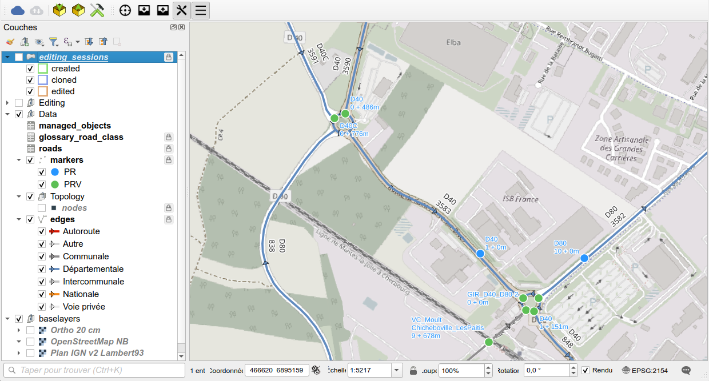
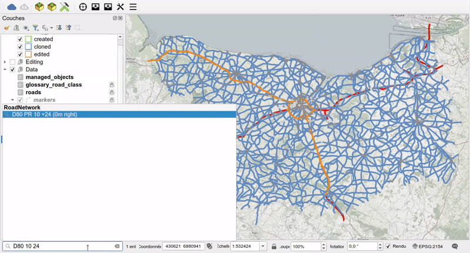
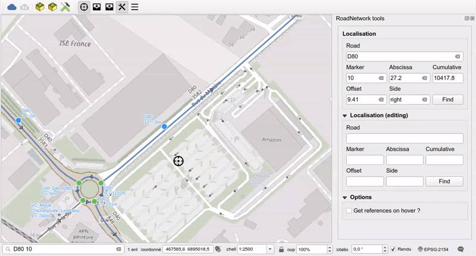

# QGIS project and tools

## Administration project

The algorithm `Create database local interface` creates a **QGIS administration project**
with all the layers, styles, labels and actions needed to visualize and edit the road network.

The project contains the following groups of layers:

* `editing_sessions`: the areas of the editing sessions (created, cloned, edited),
  see [Road graph editing](graph-editing.md),
* `Editing`: the layers of the editing session schema,
* `Data`: the production data
    * `managed_objects`: the list of business tables based on the road network,
      see [Managed objects](managed-objects.md),
    * `glossary_road_class` and `roads`,
    * `markers`: reference points (PR) and virtual markers (PRV),
    * `Topology`: the `nodes` and `edges`, styled by road class,
* `baselayers`: the background maps.

## Quick search

The QGIS **locator search bar** (`CTRL+K`) can be used to search a road or a position on a road.
No prefix is needed: the RoadNetwork results are displayed in the `RoadNetwork` group.

Type the road code and, optionally, the marker code, the abscissa, the offset and the side, separated by spaces:

* `D40`: highlights the whole road,
* `D40 1 151`: centers the map on the point `D40 PR 1 + 151m`,
* `D40 1 151 3 left`: same point, with an offset of `3m` on the left side.

## Get references on map click

The tool `Get references under the cursor` shows the **references** of the point under the mouse:
road code, marker, abscissa, offset and side. It can be toggled with the plugin toolbar button
or with the shortcut `CTRL+SHIFT+K`. Hovering over the map is supported.

